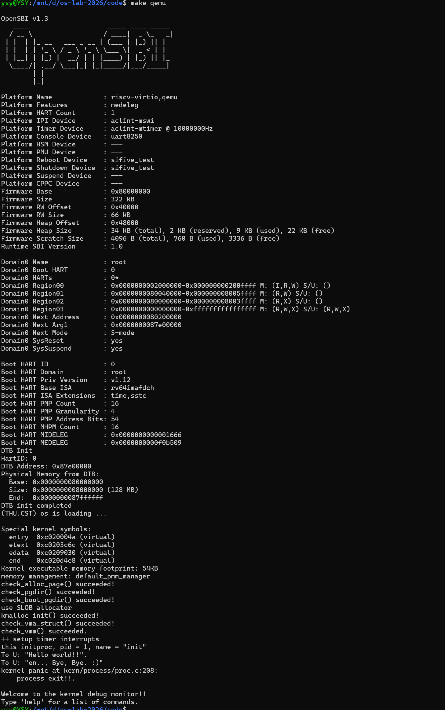

# 操作系统实验报告

## 实验基本信息

| 项目 | 内容 |
|------|------|
| **实验名称** | Lab 4: 进程管理（虚拟内存页操作 / 内核线程 / 调度） |
| **小组成员** | 2412796-杨斯源（组长）、2413628-黄乐仁、2410868-孙锘梵 |
| **完成日期** | 待填写 |

### 小组分工

练习如何分工？

| 成员 | 负责的练习/模块 |
|------|----------------|
| 2412796-杨斯源（组长） | 部分三：进程调度（`cpu_idle` / `schedule` / `proc_run` / `switch_to`）+ 收口与验证 |
| 2413628-黄乐仁 | 部分一：虚拟内存页操作（`page_insert` / `page_remove`）+ 补回 lab2 / lab3 的代码 |
| 2410868-孙锘梵 | 部分二：进程创建及初始化（`alloc_proc` / `proc_init` / `kernel_thread` / `do_fork` / `copy_thread` / `copy_mm`） |

实验报告如何分工？

报告的撰写按上表划分：各功能模块由其负责人撰写对应章节；实验环境、总结与收获及 `prompt.md` 的汇总由部分三负责人负责；最后经统一校对格式与图片引用后提交。

---

## 一、实验目的

本实验的主要目的是：

1. **掌握虚拟内存页的管理接口**：在多级页表框架上实现 `page_insert()` 与 `page_remove()`，理解"页表项内容、物理页引用计数、TLB 状态"三者必须同步。
2. **理解进程控制块与内核线程**：掌握 `struct proc_struct` 各字段的含义，理解 `idleproc` 与 `initproc` 的创建方式差异，以及"复制现有进程"这一创建模型。
3. **掌握线程首次运行的上下文构造**：理解 `kernel_thread → do_fork → copy_thread → forkret → forkrets → __trapret` 这条链路如何让新线程从指定函数入口开始执行。
4. **理解上下文切换与调度**：掌握 `struct context` 为什么只保存被调用者保存寄存器，理解 `switch_to` 的寄存器交换、`proc_run` 的页表切换与 `schedule` 的选线程策略。

---

## 二、实验环境

| 成员 | AI 编程工具 | 底层模型 | 备注 |
|------|------------|---------|------|
| 2412796-杨斯源 | 待填写 | 待填写 | |
| 2413628-黄乐仁 | 待填写 | 待填写 | |
| 2410868-孙锘梵 | 待填写 | 待填写 | |

**运行环境：**

| 组件 | 版本 / 包名 |
|------|-------------|
| 操作系统 | 待填写 |
| 交叉编译器 | 待填写 |
| 模拟器 | 待填写 |
| 调试器 | 待填写 |

**本实验做的环境适配**（与 lab2/lab3 同源，已提交在 `code/` 内）：

| 位置 | 改动 | 原因 |
|---|---|---|
| `Makefile`、`tools/grade.sh` | `-device loader,file=...,addr=0x80200000` → `-kernel bin/ucore.img` | QEMU ≥ 8 自带 OpenSBI 为 fw_dynamic，跳转地址必须由 QEMU 告知，否则内核不执行 |
| `kern/init/entry.S` | 启动页表补回低 1G 恒等映射 | 打开分页瞬间 PC 仍在物理地址 `0x8020xxxx`，不映射会立即取指页错误 |
| `kern/mm/default_pmm.c` | 删除不存在的 `#include <best_fit_pmm.h>` | 工程中无此头文件，保留则编译失败 |
| `Makefile` | GDB 命令自动探测 `riscv64-unknown-elf-gdb` / `gdb-multiarch` | apt 仓库没有前者 |
| `tools/grade.sh` | 不设 GDB 断点，跑满固定时间后收串口日志 | 原脚本的断点地址按老平台约定推导，在 riscv64 上不可用 |

---

## 三、实验整体逻辑分析

### 3.1 本章节的逻辑主线

> **待填写（负责人：杨斯源）**
> 建议围绕：本章把"单执行流内核"扩展为"可创建、可调度多线程的内核"。
> 核心链路：`kern_init → pmm_init → vmm_init → proc_init → cpu_idle → schedule → proc_run → switch_to`。
> 前半段准备地址空间与进程管理结构，后半段让第一个可运行线程真正跑起来。

### 3.2 功能的逐步实现

> **待填写（负责人：杨斯源）**
> 建议按"为什么是这个顺序"来写：先补回 lab2/lab3 代码 → 页表映射接口（否则线程地址空间无从谈起）→ PCB 与 idleproc/initproc（没有进程对象就无从调度）→ 调度与切换（有了对象还要让 CPU 真正切过去）→ 验证。

---

## 四、实验内容与实现

### 前置：补回 lab2 与 lab3 的代码

**负责人：** 2413628-黄乐仁、2410868-孙锘梵

实验指导书要求"使用此前设计的提示词生成相应实验代码，并填写到标有 lab2/lab3 注释的位置"。本实验代码中有以下四处：

| 位置 | 需要补回的内容 | 建议负责人 |
|---|---|---|
| `kern/mm/default_pmm.c`（第 6 行附近） | lab2 的 Best-Fit 管理模块（`free_area` + 五个管理函数 + 管理器注册） | 孙锘梵（lab2 写过 Best-Fit） |
| `kern/mm/pmm.c`（第 90 行附近） | lab2 的 `page_init()` | 黄乐仁（lab2 写过 `page_init`） |
| `kern/trap/trap.c`（第 86 行附近） | lab3 的 `interrupt_handler()` / `exception_handler()` | 孙锘梵（lab3 写过两个 handler） |
| `kern/trap/trapentry.S`（第 56、63 行附近） | lab3 的 `RESTORE_ALL` 与 `__alltraps` 调用部分 | 黄乐仁（lab3 写过 `RESTORE_ALL`） |

> **注意**：管理器结构体名在本实验中是 `default_pmm_manager`（见 `kern/mm/default_pmm.h`），
> 但内部函数仍叫 `best_fit_*`、测试函数仍叫 `best_fit_check()`；补回 lab2 代码时只需改名、保留逻辑。
> `basic_check()` 与 `best_fit_check()` 由框架提供，**不得修改或重复实现**。

**补回后的验证：** `make` 能通过、`make qemu` 能启动到 `vmm_init` 的页表检查。

---

### 功能模块一：虚拟内存页操作功能

**负责人：** 2413628-黄乐仁

**需要实现的函数（`kern/mm/pmm.c`）：**

```c
int  page_insert(pde_t *pgdir, struct Page *page, uintptr_t la, uint32_t perm);
void page_remove(pde_t *pgdir, uintptr_t la);
```

**功能说明：** > **待填写（负责人：黄乐仁）**

**注意事项（指导书原文要点）：**

- `page_insert` 不能简单覆盖旧页表项，要区分"原地址已映射到同一物理页"与"已映射到其他物理页"两种情况，分别处理引用计数。
- `get_pte(pgdir, la, 1)` 可能分配中间级页表页，**分配失败必须返回 `-E_NO_MEM` 且不留下半完成映射**。
- `page_remove` 要能处理"目标地址本来就没有映射"的情形，安静返回。
- 所有页表更新后都要 `tlb_invalidate()`，否则测试中会出现"页表已改、翻译还是旧的"。

**验收标准：**

- `[Test PMM] PASS` —— 10 分。

**最终提示词：** > **待填写：见 `report/prompt.md` 第一节「提示词 0」，并在此粘贴定稿原文。**

**实现迭代过程：** > **待填写（负责人：黄乐仁）：记录 AI 生成的 `page_insert`/`page_remove` 出现的问题（引用计数、TLB、失败回滚等）以及如何定位修复。**

---

### 功能模块二：进程创建及初始化功能

**负责人：** 2410868-孙锘梵

**需要实现的函数（`kern/process/proc.c`）：**

```c
static struct proc_struct *alloc_proc(void);
void proc_init(void);
int  kernel_thread(int (*fn)(void *), void *arg, uint32_t clone_flags);
int  do_fork(uint32_t clone_flags, uintptr_t stack, struct trapframe *tf);
static void copy_thread(struct proc_struct *proc, uintptr_t esp, struct trapframe *tf);
static int  copy_mm(uint32_t clone_flags, struct proc_struct *proc);
```

**功能说明：** > **待填写（负责人：孙锘梵）**

**注意事项（指导书原文要点）：**

- `alloc_proc` 要把 PCB 置于安全的空白状态，避免后续代码误用未初始化字段。
- `proc_init` 中 `idleproc` **不是 fork 出来的**，而是直接复用当前执行现场（`bootstack`、`pid = 0`、`need_resched = 1`）。
- `kernel_thread` 与 `copy_thread` 必须配合 `forkret → forkrets → __trapret` 形成正确的首次运行链路：`context.ra = forkret`、`tf->epc = kernel_thread_entry`、`tf->gpr.s0 = fn`、`tf->gpr.s1 = arg`。
- `do_fork` 的前三步（PCB、内核栈、mm）失败时必须回滚释放；成功后 `wakeup_proc`。
- 本阶段 `copy_mm` 只做占位：内核线程 `mm` 为 `NULL`，不做真正的地址空间复制。

**验收标准：**

- `[Test Process Create] PASS` —— 10 分（检查 `idleproc` 的 pid/state/kstack/parent/mm/tf/runs/flags/context，以及 `initproc` 的 pid/parent/context.ra/sp）。

**最终提示词：** > **待填写：见 `report/prompt.md` 第二节「提示词 0」，并在此粘贴定稿原文。**

**实现迭代过程：** > **待填写（负责人：孙锘梵）：记录首次运行链路、栈布局、状态位等问题与解决过程。**

---

### 功能模块三：进程调度

**负责人：** 2412796-杨斯源（组长）

**需要实现的函数：**

```c
void cpu_idle(void);                                  // kern/process/proc.c
void schedule(void);                                  // kern/schedule/sched.c
void proc_run(struct proc_struct *proc);              // kern/process/proc.c
void switch_to(struct context *from, struct context *to);  // kern/process/switch.S
```

**功能说明：** > **待填写（负责人：杨斯源）**

**注意事项（指导书原文要点）：**

- `schedule` 与 `proc_run` 的临界区必须关中断（`local_intr_save/restore`），否则 `current`、页表与实际执行现场可能不一致。
- 选线程三种情形：当前不是 idleproc → 从下一个开始找（轮转）；当前是 idleproc → 从头找；都找不到 → 退回 idleproc。
- `proc_run` 要更新 `current`、`write_csr(satp, ...)` 切页表、`flush_tlb()`，再 `switch_to`。
- **`libs/riscv.h` 的 `lsatp()` 是 Sv32 遗留，无法表达 Sv39 的 satp，不可使用**；参照 `kern/mm/pmm.c` 的 `enable_paging()` 写法。
- `switch_to` 只交换 `struct context` 里的 14 个寄存器（`ra`/`sp`/`s0..s11`），不做策略判断；新线程第一次运行靠 `context.ra = forkret`。

**验收标准：**

- `[Test Schedule] PASS` —— 10 分；另需输出 `this initproc, pid = 1, name = "init"`、`To U: "Hello world!!".`、`To U: "en.., Bye, Bye. :)"`。

**最终提示词：** > **待填写：见 `report/prompt.md` 第三节「提示词 0」，并在此粘贴定稿原文。**

**实现迭代过程：** > **待填写（负责人：杨斯源）：记录 `switch_to` 汇编、satp 切换、调度死循环等问题与解决过程。**

---

### 扩展练习（Challenge，思考题）

> **待填写（负责人：全体，由部分三汇总）**
>
> 1. 说明 `local_intr_save(intr_flag); ... local_intr_restore(intr_flag);` 是如何实现开关中断的。
> 2. `get_pte()` 中的两段相似代码：结合 sv32 / sv39 / sv48 的异同，解释它们为什么如此相像。
> 3. `get_pte()` 把"查找页表项"和"分配页表页"合并在一个函数里，这种写法好不好？有没有必要拆开？

---

## 五、测试与验证

**编译与运行（`make qemu`）：**

> **待填写（负责人：杨斯源）**：描述启动过程中能看到的关键输出（内存管理信息、`check_pgdir() succeeded!`、initproc 的三行输出等）。



**自动评分（`make grade`）：**

| 测试 | 检查内容 | 分值 | 结果 |
|---|---|---|---|
| Test PMM | 页表映射建立/撤销与引用计数 | 10 | 待填写 |
| Test Process Create | `idleproc` / `initproc` 的 PCB 字段 | 10 | 待填写 |
| Test Schedule | 线程创建、轮转调度、切换执行 | 10 | 待填写 |
| **总分** | | **30** | 待填写 |


---

## 六、实验总结与收获

### 对操作系统的理解

**1. 本实验中重要的知识点，及与 OS 原理中对应知识点的关系**

> **待填写（负责人：杨斯源）**：建议覆盖——虚拟内存与地址空间、页表项与 TLB、进程控制块、上下文（caller-saved / callee-saved）、线程与进程的区别、调度策略（FIFO/轮转）、原子性与临界区。

**2. OS 原理中很重要、但本实验没有对应上的知识点**

> **待填写（负责人：杨斯源）**：建议覆盖——进程阻塞与唤醒的真实使用、优先级调度、多核与 IPI、用户态进程与系统调用、缺页异常与按需分页、进程间通信、内存映射文件。

### AI 协作开发的经验

> **待填写（负责人：杨斯源）**：结合本实验真实经过写（首次运行链路难描述、汇编上下文、`satp` 写法、调试手段等）。

---

## 七、提交前自检

- [ ] 四处 lab2/lab3 代码已补回，五处 `LAB4 functionN YOUR CODE` 已填并替换为学号
- [ ] `SAVE_ALL`、`struct trapframe`、`trap()` 签名未被修改；未改动框架提供的测试函数
- [ ] `make` 在 `-Werror` 下无警告通过，`make grade` 30/30
- [ ] 全文无"待填写"；每个功能模块都有「最终提示词」与「实现迭代过程」
- [ ] `prompt.md` 三节齐全，迭代记录表已填
- [ ] `images/` 下截图齐全且为真实截图，路径为相对路径
- [ ] 成果在 `lab4` 分支，根目录只有 `code/` 与 `report/`
