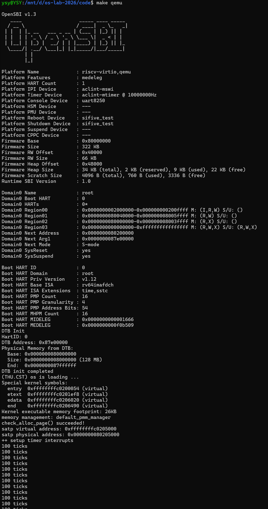
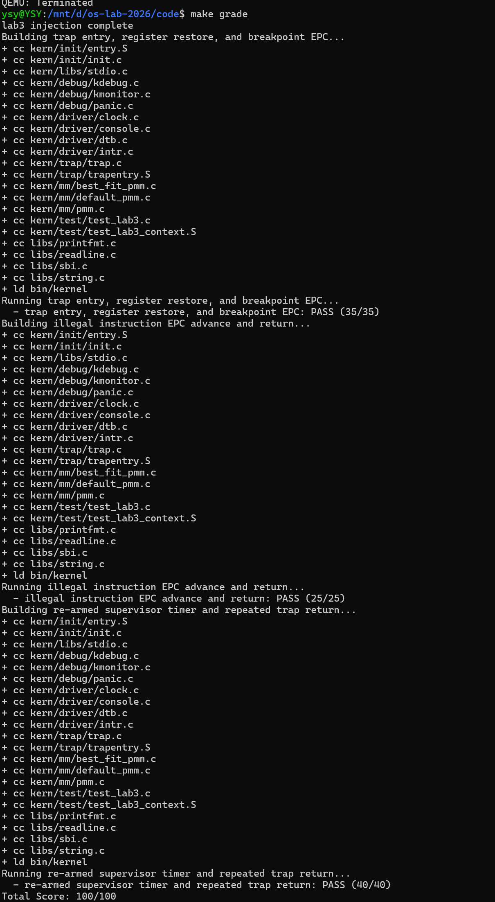

# 操作系统实验报告

## 实验基本信息

| 项目 | 内容 |
|------|------|
| **实验名称** | Lab 3: 断，都可以断（中断与异常） |
| **小组成员** | 2412796-杨斯源（组长）、2413628-黄乐仁、2410868-孙锘梵 |
| **完成日期** | 2026-11-05 |

### 小组分工

练习如何分工？

| 成员 | 负责的练习/模块 |
|------|----------------|
| 2412796-杨斯源（组长） | 部分三：收口与验证（报告汇总 + 全量验证 + 格式校对） |
| 2413628-黄乐仁 | 部分一：Trap 上下文恢复与 Trap 入口（`RESTORE_ALL` + `__alltraps`）+ 补回 lab2 的 `page_init()` |
| 2410868-孙锘梵 | 部分二：中断与异常处理（`interrupt_handler` + `exception_handler`）+ 补回 lab2 的 Best-Fit |

实验报告如何分工？

报告的撰写按上表划分：各功能模块由其负责人撰写对应章节；实验环境、总结与收获及 `prompt.md` 的汇总由部分三负责人负责；最后经统一校对格式与图片引用后提交。

---

## 一、实验目的

本实验的主要目的是：

1. **理解 RISC-V 的中断与异常机制**：区分「中断（异步、外部事件）」与「异常（同步、指令执行引起）」，理解 M/S/U 特权级、`scause`/`sepc`/`stvec`/`sstatus` 等 CSR 的作用，以及 OpenSBI 如何把 S 模式下的 Trap 委托给内核处理。
2. **掌握 Trap 上下文的保存与恢复**：理解 `struct trapframe` 的布局与 `SAVE_ALL` 的保存关系，据此实现对应的 `RESTORE_ALL`，并让 `__alltraps` 按 RISC-V 调用约定把 Trap frame 交给 C 语言处理函数。
3. **掌握中断与异常处理程序的编写**：实现时钟中断的「设置下一次事件 → 计数 → 输出统计」，以及非法指令、断点异常的识别与 `sepc` 修正，理解为什么异常返回前必须正确更新 `epc`。
4. **理解中断的关闭与开启及原子操作**：理解为什么部分操作需要关中断保护，掌握 `local_intr_save/restore` 与 `atomic.h` 提供的位操作。

---

## 二、实验环境

| 成员 | AI 编程工具 | 底层模型 | 备注 |
|------|------------|---------|------|
| 2412796-杨斯源 | Claude Code（终端 Agent） | DeepSeek V4 Flash | |
| 2413628-黄乐仁 | Claude Code（终端 agent） | DeepSeek V4 Flash | |
| 2410868-孙锘梵 |DeepSeek Harness|deepseek-flash| |

**运行环境：**

| 组件 | 版本 / 包名 |
|------|-------------|
| 操作系统 | Ubuntu 24.04.5 LTS（WSL2） |
| 交叉编译器 | `riscv64-unknown-elf-gcc` 15.1.0 |
| 二进制工具 | `riscv64-unknown-elf-ld` / `objcopy` / `objdump` |
| 模拟器 | `qemu-system-riscv64` 8.2.2（apt 包 `qemu-system-misc`，自带 OpenSBI v1.3） |
| 调试器 | `riscv64-unknown-elf-gdb` 16.3.90 |

---

## 三、实验整体逻辑分析

### 3.1 本章节的逻辑主线

本章围绕 **“操作系统如何感知并响应外部事件”** 展开，在 lab2 已经具备内存管理与分页能力的内核之上，加入对**中断（interrupt）**与**异常（exception）**的支持，并用时钟中断来验证整套机制。

整章的核心是打通一条**完整的 Trap 闭环**：

```
外部事件 / 指令异常
      ↓ 硬件按 stvec 跳转
__alltraps  →  SAVE_ALL 保存现场（构造 trapframe）
      ↓ 按 RISC-V 调用约定把 tf 传给 C
trap(tf)  →  trap_dispatch 按 cause 分派
      ↓
interrupt_handler() / exception_handler()
      ↓ 返回
__trapret  →  RESTORE_ALL 恢复现场  →  sret 回到被打断的地方
```

这条闭环要回答三个递进的子问题：**怎么进入内核**（`stvec` 指向哪里）、**怎么保存和恢复现场**（trapframe 与 `SAVE_ALL`/`RESTORE_ALL` 的对称关系）、**怎么处理不同的事件**（按 `scause` 分派，并让时钟中断持续工作）。

与 lab1/lab2 不同的是，本章第一次让内核**从“顺序执行”变成“可被打断、可被打断后继续”**——这是后面进程、调度、同步等一切机制的基础。

### 3.2 功能的逐步实现

本章按如下顺序逐步实现，每一步都为下一步提供前提：

1. **先把 lab2 的代码补回来**（`page_init()` 与 Best-Fit）。
   → 为什么先做这个？本实验依赖 lab2，代码树上留有两处 `//lab2 请补充你在lab2中的代码`；不补回则编译/链接都过不去，后面的 Trap 无从验证。

2. **设置 Trap 入口**（`idt_init()` 把 `stvec` 写成 `__alltraps`，并把 `sscratch` 清 0）。
   → 为什么接着做？硬件发生 Trap 时只会按 `stvec` 跳转；不设好入口，事件发生后 CPU 会跳到未定义位置。

3. **保存现场并构造 trapframe**（已提供的 `SAVE_ALL`）。
   → 为什么然后做？C 语言的处理器需要一份完整、布局固定的上下文；`SAVE_ALL` 把 32 个通用寄存器和 4 个 CSR 压到内核栈上，形成 `struct trapframe`。**这一步的关键是 `x2(sp)` 的特殊处理**：原 sp 经由 `sscratch` 中转后存到单独的槽位。

4. **在汇编与 C 之间建立调用关系**（`__alltraps` 里 `mv a0, sp; jal trap`）。
   → 为什么接着做？`a0` 是 RISC-V 的第一个参数寄存器，把 trapframe 地址交给 `trap()`，才能进入 C 世界处理。

5. **恢复现场并返回**（补 `RESTORE_ALL`）。
   → 为什么然后做？处理完必须回到被打断的地方。`RESTORE_ALL` 必须与 `SAVE_ALL` **严格对称**；并且因为恢复过程中还要用 `sp` 去读栈，**`sp` 必须最后恢复**。

6. **按 cause 分派并实现两个处理器**（`trap_dispatch` → `interrupt_handler` / `exception_handler`）。
   → 为什么接着做？中断与异常的处理方式完全不同：中断要“处理后继续”，异常要“修正 `epc` 后继续”。`scause` 最高位为 1 表示中断，这就是分派依据。

7. **让时钟中断形成闭环**（`clock_init` 设置首次事件 → 每次中断重新 `clock_set_next_event()` → `ticks++`）。
   → 为什么最后做？`sbi_set_timer` 安排的是一次性事件，**不重新设置就只会中断一次**。这一步同时验证了“Trap 能反复进出”这一核心能力。

---

## 四、实验内容与实现

### 前置：补回 lab2 的实验代码

**负责人：** 2413628-黄乐仁（`page_init()`）、2410868-孙锘梵（Best-Fit）

**说明：** 实验指导书要求「使用你此前设计的提示词生成相应实验代码，并将生成结果填写到本实验代码中标有'lab2'注释的对应位置」。本实验的代码中有两处 `//lab2 请补充你在lab2中的代码`：

| 位置 | 需要补回的内容 |
|---|---|
| `kern/mm/pmm.c`（第 84 行附近） | lab2 的 `page_init()` |
| `kern/mm/best_fit_pmm.c`（第 7 行附近） | lab2 的 Best-Fit 管理模块（`free_area` + 五个管理函数 + `best_fit_pmm_manager` 注册结构；**两个测试函数已由实验提供，不要重复实现**） |

**最终提示词：** 见 [`report/prompt.md`](./prompt.md) 对应小节（即 lab2 使用过的提示词）。

**补回后的验证：** 代码应能编译通过，且 `make grade` 中前两项（`page init` / `best fit`）仍为 OK。

**Best-Fit 补回说明（2410868-孙锘梵）：**

`kern/mm/best_fit_pmm.c` 中的 `basic_check()` 与 `best_fit_check()` 两个测试函数已由实验框架提供，补回时只需补齐缺失的三部分：

| 补回内容 | 说明 |
|---|---|
| 空闲区结构 | `static free_area_t free_area;`，并用两个宏把 `free_list` / `nr_free` 映射到它的成员；已提供的测试函数正是通过这两个名字访问空闲链表，缺了会直接编译失败 |
| 五个管理函数 | `best_fit_init`、`best_fit_init_memmap`、`best_fit_alloc_pages`、`best_fit_free_pages`、`best_fit_nr_free_pages` |
| 管理器注册 | `const struct pmm_manager best_fit_pmm_manager`，把五个函数指针与 `.check = best_fit_check` 绑定 |

与 First-Fit 的实质差别只有 `best_fit_alloc_pages()` 的选块策略：First-Fit 遇到第一个 `property >= n` 的块就返回，Best-Fit 则遍历整条空闲链表，在所有满足条件的块中挑 `property` 最小的那一块，以减少本次分配对空闲区造成的碎片。

最终提示词见 [`report/prompt.md`](./prompt.md) 第二节「提示词 0」。

---

### 功能模块一：Trap 上下文恢复与 Trap 入口功能

**负责人：** 2413628-黄乐仁

**需要实现/修改的汇编功能（`kern/trap/trapentry.S`）：**

```asm
RESTORE_ALL     # 与已提供的 SAVE_ALL 对应的恢复逻辑
__alltraps      # 在 SAVE_ALL 之后调用 C 语言 trap(struct trapframe *tf)
```

**功能说明：**

本模块负责完成 Trap 从「进入内核」到「返回原执行流」之间的底层上下文管理。`SAVE_ALL` 已经负责把 Trap 发生时的处理器状态保存到当前内核栈上的 Trap frame 中，需要根据这一已有的保存关系设计提示词，让 AI 完成对应的 `RESTORE_ALL`，使被打断程序的执行状态能够从 Trap frame 中恢复出来。同时，`__alltraps` 需要建立汇编 Trap 入口与 C 语言 `trap(struct trapframe *tf)` 之间的调用关系，使保存后的 Trap frame 能够按照 RISC-V 调用约定正确传递给 `trap()`。

**注意事项（指导书原文要点）：**

- `RESTORE_ALL` 必须与已经提供的 `SAVE_ALL` 保持对应关系，**不能自行假设一个与实际 Trap frame 不一致的数据布局**。
- 特别注意：`SAVE_ALL` 中对 **`x2(sp)` 的处理方式与其他通用寄存器并不完全相同**，因此恢复时不能简单地把所有寄存器按完全相同的方式恢复。
- `__alltraps` 需要保证 Trap frame 的地址能按 RISC-V 调用约定作为 `trap()` 的参数传递，同时不能破坏后续恢复上下文所需的信息。
- **不得修改 `SAVE_ALL`、`struct trapframe` 和 `trap()` 的函数签名。**

**验收标准（来自 `tools/grade.sh`）：**

- `[Test 1] Trap entry and breakpoint return: PASS (35/35)` —— 35 分
- 需要看到输出 `Breakpoint at`

**最终提示词：**

定稿原文如下，全文同时收录于 [`report/prompt.md`](./prompt.md) 第一节「提示词 1」。

````markdown
[PROMPT]
**任务**：修改 `kern/trap/trapentry.S`，在 `//lab3 function1 YOUR CODE` 处补全 `RESTORE_ALL` 宏，并在 `__alltraps` 中建立与 C 函数 `trap(struct trapframe *tf)` 的调用关系，把 `YOUR CODE` 替换为我的学号 `2413628`。

**操作要求**：必须在项目中修改实际文件；只补 `RESTORE_ALL` 与 `__alltraps` 两处，`SAVE_ALL`、`__trapret`、`struct trapframe`、`trap()` 的函数签名一律不动；必须在 `-Werror` 下编译通过。

**输出要求**：使用下方信息，以工程真实定义为准。

[RELY]
```asm
/* 寄存器宽度：rv64 下 REGBYTES = 8，STORE = sd，LOAD = ld */

/* struct trapframe 布局（kern/trap/trap.h），栈上共 36 个 slot × 8 字节：
     gpr[0..31]  // struct pushregs，32 个通用寄存器（下标 = 寄存器号）
     status      // slot 32 —— sstatus
     epc         // slot 33 —— sepc
     badvaddr    // slot 34 —— stval
     cause       // slot 35 —— scause */

/* 已提供的 SAVE_ALL（不允许修改，RESTORE_ALL 必须与之严格对称）： */
.macro SAVE_ALL
    csrw sscratch, sp           // 先把被打断前的 sp 暂存到 sscratch
    addi sp, sp, -36 * REGBYTES // 在内核栈上开 36 个 slot 的 trapframe
    STORE x0,  0*REGBYTES(sp)
    STORE x1,  1*REGBYTES(sp)
    STORE x3,  3*REGBYTES(sp)
    ...                         // x4..x31 依次存到对应下标（slot 2 留空，见下）
    STORE x31, 31*REGBYTES(sp)
    csrrw s0, sscratch, x0      // 取回原 sp，同时把 sscratch 清 0（标记“来自内核”）
    csrr s1, sstatus
    csrr s2, sepc
    csrr s3, stval
    csrr s4, scause
    STORE s0, 2*REGBYTES(sp)    // 原 sp 存到 slot 2
    STORE s1, 32*REGBYTES(sp)   // sstatus → slot 32
    STORE s2, 33*REGBYTES(sp)   // sepc    → slot 33
    STORE s3, 34*REGBYTES(sp)   // stval   → slot 34
    STORE s4, 35*REGBYTES(sp)   // scause  → slot 35
.endm
```

```
/* RISC-V 调用约定：a0 是第一个参数寄存器；jal 把返回地址写回 ra（x1）。
   trap() 声明为 void trap(struct trapframe *tf)，入参 tf 就是 trapframe 指针。 */
/* 返回：sret 会把 sepc 写回 pc，所以 epc 是否被 handler 修正，决定了返回后从哪条指令继续。 */
```

[GUARANTEE]
```asm
RESTORE_ALL            // .macro，恢复被打断现场
__alltraps             // 入口，SAVE_ALL 之后把 tf 传给 trap()
```

[SPECIFICATION]
## RESTORE_ALL
**Pre-Condition**：`sp` 指向当前内核栈上的完整 trapframe（36 slot，由 `SAVE_ALL` 建立）。
**Post-Condition**：除 `x0`、`sp` 外的通用寄存器恢复到 trapframe 中保存的值；`sstatus`/`sepc` 已恢复；`sp` 恢复为被打断前的值。

**Requirements**：
- 恢复顺序必须与 `SAVE_ALL` 的保存布局一一对应（下标 = 槽位号）。
- `x0` 硬连线为 0，槽位 0 不必也不应被 `LOAD` 覆盖。
- `sp`（槽位 2）必须**最后**恢复：恢复其他寄存器时要继续用 `sp` 去寻址栈上数据，一旦提前改写 `sp`，后续所有 `LOAD` 都读错位置。
- 先恢复 `sepc` 与 `sstatus` 没有副作用；`sret` 会读取它们，因此恢复完直接 `sret` 即可回到被打断处。
- `x1`/`ra` 无需特殊处理：`SAVE_ALL` 已把被打断代码的返回地址存进槽位 1，`RESTORE_ALL` 用 `LOAD x1, 1*REGBYTES(sp)` 恢复即可，期间被 `jal trap` 改写的 `ra` 会被这次 `LOAD` 覆盖。
- `sscratch` 无需在 `RESTORE_ALL` 中恢复：`SAVE_ALL` 已把它清 0（用作「本次 Trap 来自内核」的标记），下一次 Trap 进入时 `SAVE_ALL` 会重新写入，旧值无需还原。

## __alltraps
**Pre-Condition**：硬件按 `stvec` 跳转至此；`SAVE_ALL` 已执行完毕，`sp` 指向 trapframe。
**Post-Condition**：`trap()` 已被调用且入参为 trapframe 指针；从 `trap()` 返回后 `sp` 仍指向同一 trapframe（供后续 `RESTORE_ALL` 使用）。

**Requirements**：
- 用 `mv a0, sp` 把 trapframe 指针放入参数寄存器 `a0`，再 `jal trap`。
- 不得在 `jal trap` 之前破坏 `sp`；`trap()` 按调用约定保存/恢复被调用者寄存器，`sp` 由调用者保证不变。
- 调用结束后落入 `__trapret`（`RESTORE_ALL` + `sret`）。
- `jal trap` 会改写 `ra`，但被打断代码的 `ra` 已被 `SAVE_ALL` 存入 trapframe 槽位 1，因此此处覆盖 `ra` 是安全的，`RESTORE_ALL` 会从栈上恢复它。
- `__alltraps` 入口的 `.align(2)` 保证 4 字节对齐，满足 `stvec` 低两位必须为 0（直接模式）的要求。
````

**实现迭代过程：**

**一、提示词的两轮调整**

*第一轮：只说了「恢复寄存器」。* 最初的提示词只有「参照 `SAVE_ALL` 写出 `RESTORE_ALL`，并让 `__alltraps` 调用 `trap()`」。AI 给出的是一版「按槽位顺序依次 `LOAD` 回 32 个通用寄存器」的代码，看起来与 `SAVE_ALL` 一一对称，但忽略了 `sp` 的特殊性——它既是栈指针又是被保存的寄存器，恢复过程中还要拿它去寻址栈上的 trapframe。

*第二轮：把 `SAVE_ALL` 原文与 trapframe 布局贴进 `[RELY]`。* 只说「与 `SAVE_ALL` 对称」，AI 并不知道槽位 2 里存的是什么。重新设计提示词时，把 `SAVE_ALL` 的完整代码、`struct trapframe` 的 36 个 slot 布局、`REGBYTES`/`STORE`/`LOAD` 的宽度约定一并写进 `[RELY]`，并把「`sp` 最后恢复」「`x0` 不恢复」「`sscratch` 无需还原」写成 `Requirements`，生成结果一次通过。

**二、实现过程中处理的问题**

1. **`sp` 必须最后恢复。** 若按槽位序号把 `sp`（slot 2）和通用寄存器一起恢复，后续的 `LOAD` 就会用一个已经改掉的栈指针去寻址，读到的全是错误数据。最终实现先恢复 `sstatus`、`sepc` 与通用寄存器，最后一条才执行 `LOAD x2, 2*REGBYTES(sp)`。
2. **`jal trap` 会覆盖 `ra`，但不影响返回。** 调用 `trap(tf)` 时 `jal` 把返回地址写进 `ra`，而被打断处的 `ra` 早已由 `SAVE_ALL` 存进 slot 1，`RESTORE_ALL` 会把它恢复回来，因此不必额外保存。
3. **Test 1 始终 0/35，根因却不在 `RESTORE_ALL`。** 编译通过、Test 2 与 Test 3 正常，唯独寄存器上下文测试全部失败。在 `__trapret` 处下 GDB 断点核对，栈上 32 个通用寄存器与四个 CSR 的数值全部正确，单步走完恢复序列 `t0` 也确实回到了 `0x105`，说明恢复逻辑本身没有问题。于是把断点移到 `ebreak` 返回后的第一条指令，发现该地址上的实际指令是 `addi a2, sp, 36`，而源码对应行是 `li a0, 0x105`——**返回地址错了**。

**根因：** 部分二的 `exception_handler` 中，断点分支硬编码了 `tf->epc += 4`（注释还写着「ebreak 是 4 字节指令」），但内核开启了 C 扩展（`rv64imafdch`），`ebreak` 会被汇编成 **16 位的 `c.ebreak`**。`epc += 4` 于是落到下一条 4 字节指令的正中间，CPU 从那里取指解出垃圾指令：

```asm
0x...1a00:  9002        ebreak        ← 2 字节（c.ebreak）
0x...1a02:  10500513    li a0,261     ← 4 字节，占 0x1a02~0x1a05
0x...1a06:  0ca29863    bne t0,a0,...
```

**解决：** 与非法指令异常一致，改为**按实际指令长度推进** `epc`——读 `epc` 处的 16 位字，低两位为 `0b11` 表示 32 位指令（+4），否则为 16 位压缩指令（+2）。修复后 Test 1 通过（35/35），`make grade` 达到 100/100。

> 这个问题**表现在部分一的测试上，根因却在部分二的处理器里**，收口阶段由组长统一定位并修复——这是本次分工里最值得记录的一处边界问题。

---

### 功能模块二：中断与异常处理功能

**负责人：** 2410868-孙锘梵

**需要实现的函数（`kern/trap/trap.c`）：**

```c
void interrupt_handler(struct trapframe *tf);
void exception_handler(struct trapframe *tf);
```

**功能说明：**

- `interrupt_handler()` 负责处理中断。其中**时钟中断**需要完成：设置下一次时钟事件、时钟计数、统计信息输出（达到规定次数时）、以及累计输出达到规定次数后的系统关机；其他类型的中断只需完成基本的类型区分和相应提示输出；**无法识别的中断**则通过已有的 `print_trapframe(tf)` 输出完整 Trap frame 以辅助调试。
- `exception_handler()` 负责处理实验要求的异常。其中**非法指令异常**和**断点异常**需要输出规定格式的信息，并**根据对应指令的长度正确更新 `tf->epc`**，使 Trap 返回以后不会重复执行已经触发异常的指令；其他未要求具体处理的异常则使用已有的 `print_trapframe(tf)` 作为兜底处理。

**注意事项（指导书原文要点）：**

- 时钟中断**不能只计数而不设置下一次时钟事件**，否则系统只能收到一次时钟中断。
- `ticks` 每收到一次时钟中断必须增加一次；达到 `TICK_NUM` 的整数倍时输出规定格式的统计信息。
- 非法指令与断点异常必须严格按实验规定的输出格式处理，并正确更新 `tf->epc`，否则返回后会**再次执行同一条异常指令形成异常循环**。
- **不同异常对应的指令长度可能不同**，不能假定所有异常都用相同的 `epc` 偏移量，需要结合 RISC-V 指令编码规则判断。
- 未列出的异常类型只需调用 `print_trapframe(tf)` 兜底输出。
- **不得修改函数签名，也不得修改 `trap.c` 中规定以外的其他函数。**

**验收标准（来自 `tools/grade.sh`）：**

- `[Test 2] Illegal instruction return: PASS (25/25)` —— 25 分
  需要看到：`Illegal instruction at`、`Supervisor software interrupt`、`Unknown interrupt: cause 15`、`cause    0x00000014`
- `[Test 3] Sustained supervisor timer: PASS (40/40)` —— 40 分
  需要看到：`100 ticks`、`ticks=200`

**最终提示词：**

两个 handler 各使用一份独立提示词，全文见 [`report/prompt.md`](./prompt.md) 第二节的「提示词 1」「提示词 2」。定稿原文如下。

````markdown
[PROMPT]
**任务**：修改 `kern/trap/trap.c`，在 `//lab3 function2 YOUR CODE` 处实现 `interrupt_handler()`，使内核能区分并处理 S 模式的时钟、软件、外部中断，并对无法识别的中断做兜底输出。

**操作要求**：必须在项目中修改实际文件；新增代码写入标记处且位于 `trap_dispatch()` 之前；`idt_init()`、`print_trapframe()`、`print_ticks()` 等既有函数保持不动；该函数**不得声明为 `static`**。

**输出要求**：使用下方信息，以工程真实定义为准。

[RELY]
```c
// libs/riscv.h
IRQ_S_SOFT   1
IRQ_S_TIMER  5
IRQ_S_EXT    9

// driver/clock.h、trap.c
extern volatile size_t ticks;      // 累计时钟中断次数
void clock_set_next_event(void);   // 安排下一次时钟事件（一次性）
#define TICK_NUM 100
static void print_ticks(void);      // 已提供，输出统计信息

void print_trapframe(struct trapframe *tf);
void cprintf(const char *fmt, ...);
```

```
// scause 最高位为 1 表示中断，原因编号位于低位；
// 入参 tf->cause 按 scause 原值约定，可能带也可能不带最高位。
```

[GUARANTEE]
```c
void interrupt_handler(struct trapframe *tf);   // 不得为 static
```

[SPECIFICATION]
## interrupt_handler
**Pre-Condition**：`tf` 有效，`tf->cause` 为 `scause` 原值。
**Post-Condition**：对应中断处理完毕，函数正常返回；`tf->epc` 不被修改（中断返回后应继续执行被打断的指令）；处理过程中不关闭中断使能、不调用 `panic()`。
**Case 1**（`IRQ_S_TIMER`）：先重新安排下一次时钟事件，再累加 `ticks`；计数每满 `TICK_NUM` 输出一次统计信息。
**Case 2**（`IRQ_S_SOFT`）：输出一行可辨识的 S 模式软件中断提示。
**Case 3**（`IRQ_S_EXT`）：输出一行可辨识的 S 模式外部中断提示。
**Case 4**（其他中断号）：先输出含该中断号十进制值的提示，再打印完整 Trap frame 作为兜底。

**Requirements**：
- 判断类型前必须先剥离 `scause` 的最高位；输出的中断号同样取剥离后的值。
- 时钟分支中「重新安排下一次事件」必须先于其他处理，任何路径都不得漏设，否则时钟中断只到来一次。
````

````markdown
[PROMPT]
**任务**：修改 `kern/trap/trap.c`，在 `//lab3 function2 YOUR CODE` 处实现 `exception_handler()`，按异常原因处理非法指令与断点，并保证处理完成后返回原执行流而不再触发同一条指令。

**操作要求**：必须在项目中修改实际文件；新增代码写入标记处且位于 `trap_dispatch()` 之前；`interrupt_handler()`、`trap_dispatch()`、`trap()` 等既有函数保持不动；该函数**不得声明为 `static`**。

**输出要求**：使用下方信息，以工程真实定义为准。

[RELY]
```c
// trap.h
struct trapframe { struct pushregs gpr; uintptr_t status, epc, badvaddr, cause; };

// libs/riscv.h
CAUSE_ILLEGAL_INSTRUCTION  0x2
CAUSE_BREAKPOINT           0x3

void print_trapframe(struct trapframe *tf);
void cprintf(const char *fmt, ...);
```

```
// 异常 cause 为非负小整数，不需要剥离标志位；sret 会把 sepc 装回 pc。
```

[GUARANTEE]
```c
void exception_handler(struct trapframe *tf);   // 不得为 static
```

[SPECIFICATION]
## exception_handler
**Pre-Condition**：`tf` 有效，`tf->cause` 为异常原因。
**Post-Condition**：非法指令与断点处理完成后，`tf->epc` 已指向触发异常的指令之后；其他异常 `tf->epc` 保持不变；函数正常返回，不调用 `panic()`。
**Case 1**（`CAUSE_ILLEGAL_INSTRUCTION`）：输出含 `tf->epc` 数值的提示，再按该地址处指令的编码决定前进长度并更新 `tf->epc`：最低两位为 `0b11` 是 32 位指令，否则是 16 位压缩指令。
**Case 2**（`CAUSE_BREAKPOINT`）：输出含 `tf->epc` 数值的提示；`ebreak` 为 4 字节指令，`tf->epc` 前进 4。
**Case 3**（其他异常）：不改变 `tf->epc`，打印完整 Trap frame 作为兜底。

**Requirements**：
- 必须更新 `tf->epc`，否则返回后再次执行同一条异常指令，形成异常循环。
- 指令长度只能由编码判定，不能写死偏移量。
- 只有非法指令分支读取 `tf->epc` 处的内存；兜底分支的 Trap frame 可能来自人工构造，不得无条件解引用。
- 打印 64 位地址时使用 64 位格式化符，避免截断。
````

**实现迭代过程：**

**一、提示词的三轮调整**

*第一轮：从一句话到四段式。* 最初的描述只有「实现 `interrupt_handler` 和 `exception_handler`」。问题在于这两个函数唯一的入参是 `tf`，而几乎所有行为都取决于 `scause` 的编码方式与 `trapframe` 的字段语义；这些不写进 `[RELY]`，生成结果里的宏名和字段名就只能靠猜，极容易出现 `sbadaddr` / `badvaddr`、`stvec` / `sepc` 之类对不上的写法。于是把 `struct trapframe` 的布局、`IRQ_S_*` 与 `CAUSE_*` 的取值、`clock_set_next_event()` 与 `volatile size_t ticks` 的声明补入 `[RELY]`。

*第二轮：先合并、再拆分。* 一开始把两个 handler 合成一份「中断与异常处理模块」的提示词，理由是二者共享同一套 `scause` 语义。但合并后 `[RELY]` 里同时堆着中断常量与异常常量，任何一侧都用不到另一半，违背了 `[RELY]` 要「最小」的要求；而且两个 handler 的验收彼此独立。最终拆成两份提示词，各自只带自己需要的宏与函数，上下文都压到 10 行以内。

*第三轮：把体系结构约束从「说明」挪进「规格」。* 三条约束最初只打算写成说明性文字：`scause` 最高位的含义、一次性定时器必须每次重设、`epc` 必须前进。但说明性文字容易被当成建议而忽略，只有写进 `Post-Condition` 与 `Requirements` 才会真正约束生成结果。因此 `interrupt_handler` 把「`tf->epc` 不被修改」写成后置条件，把「续期必须先于其他处理」写成 `Requirements`；`exception_handler` 把「`epc` 已指向触发异常的指令之后」写成后置条件。

**二、代码的分步实现**

两个 handler 没有一次性生成，而是按「先定输入、再填分支」的顺序分四步完成，每步都能单独检查：

1. **先只做 `cause` 归一化**，把 `switch (cause)` 的骨架铺好、分支体留空。这一步的目的是先把「输入到底是什么」定死——`scause` 是原始值，最高位是中断标志，不剥离就无法比较。
2. **填时钟分支**：`clock_set_next_event()` → `ticks++` → 每满 `TICK_NUM` 调用框架已提供的 `print_ticks()`。
3. **填软件中断、外部中断、未知中断**三个分支。
4. **单独实现 `exception_handler`**：非法指令按编码判长、断点固定前进 4 字节、其余走 `print_trapframe()` 兜底。

**三、实现过程中处理的问题**

1. **`%d` 与 64 位实参不匹配。** 未知中断要输出中断号的十进制值，而 `cause` 是 `uintptr_t`（64 位）。变参函数不做类型提升，直接把 64 位值交给 `%d` 属于未定义行为。处理方式是在输出前显式转换为 `int`：`cprintf("Unknown interrupt: cause %d\n", (int)cause)`。
2. **兜底分支不能解引用 `tf->epc`。** 非法指令分支需要读回触发异常的指令来判断长度，但如果把这段读取放在函数入口统一执行，遇到人工构造的 `trapframe`（`epc` 为 0）就会直接访存失败。处理方式是只在非法指令分支内读取，兜底分支只调用 `print_trapframe(tf)`，它仅访问 `tf` 自身的字段。
3. **`-Werror` 下的声明顺序。** 框架开启了 `-Werror`，若把两个 handler 写在 `trap_dispatch()` 之后，会因为隐式声明直接编译失败。处理方式是全部写在 `trap_dispatch()` 之前。
4. **`static` 会破坏外部调用。** 本文件之外的其他代码会直接调用这两个 handler，若误加 `static` 会导致链接失败。这一点已写进两份提示词的 `[GUARANTEE]` 注释中。
5. **指导书要求的「关机」与框架不一致。** 指导书建议在统计输出累计达到 `SHUTDOWN_AFTER` 后调用关机接口，但框架中并没有定义这个阈值宏，只有 `libs/sbi.h` 提供的 `sbi_shutdown()`。而本实验的验收需要在内核运行较长时间后确认时钟计数仍在增长，过早关机会让观测窗口提前结束。综合两点，本实现只完成「续期 → 计数 → 输出」的闭环，未加入关机判断。

---

## 五、测试与验证

**编译与运行（`make qemu`）：**

OpenSBI v1.3 初始化完成后内核正常启动，之后每累计 100 次时钟中断就输出一行 `100 ticks`。能持续不断地打印，说明 `clock_set_next_event()` 在每次中断里都被重新续期——一次性定时器必须反复重设，这正是本实验要验证的「Trap 能反复进出」。



**自动评分（`make grade`）：**

`tools/grade.sh` 会用三个不同的宏分别重新编译并运行内核，三项全部通过：

| 测试 | 检查内容 | 结果 |
|---|---|---|
| Test 1 | Trap 入口与断点返回（`GRADE_LAB3_CONTEXT`） | PASS 35/35 |
| Test 2 | 非法指令返回（`GRADE_LAB3_ILLEGAL`） | PASS 25/25 |
| Test 3 | Supervisor 时钟持续触发（`GRADE_LAB3_TIMER`） | PASS 40/40 |
| **总分** | | **100/100** |



---

## 六、实验总结与收获

### 对操作系统的理解

**1. 本实验中重要的知识点，及与 OS 原理中对应知识点的关系**

| 本实验中的知识点 | 对应 OS 原理中的知识点 | 含义、关系与差异 |
|---|---|---|
| 中断与异常的区分（`scause` 最高位） | 中断（异步）与异常（同步） | 原理中二者触发来源不同、处理时机不同；本实验用 `scause` 的符号位在 `trap_dispatch` 里分流。**关系**：完全对应。 |
| M/S/U 特权级与 OpenSBI 的 Trap 委托 | 特权级与陷入内核 | 原理讲用户态陷入内核态；本实验是 S 模式内核陷入 M 模式固件（SBI 调用），以及 U→S 的中断委托（`medeleg`/`mideleg`）。**差异**：本实验的“陷入”主要是 S→M（请求固件服务），真正的 U 模式尚未登场。 |
| `struct trapframe` 与 `SAVE_ALL`/`RESTORE_ALL` | 上下文保存与恢复、进程上下文切换 | 原理中上下文切换要保存/恢复寄存器组；本实验是在**同一执行流内**保存与恢复（Trap 而不是切换）。**差异**：切换是“保存 A、加载 B”，本实验是“保存自己、恢复自己”。 |
| `stvec` / `sepc` / `scause` / `sstatus` | 中断向量表、PC、中断原因、处理器状态字 | 原理中这些是中断机制的核心寄存器；本实验直接读写它们。**差异**：x86 用 IDT + 中断号，RISC-V 用 `stvec` + `scause`。 |
| 时钟中断与 `sbi_set_timer` | 定时器/时钟中断、时间片 | 原理中时钟中断是调度的驱动力；本实验用它验证中断能反复触发。**注意**：这是**一次性定时器**，每次中断必须重新设置下一次事件。 |
| `ticks` 与关中断保护（`local_intr_save/restore`） | 临界区与原子操作 | 原理讲并发访问共享数据要保护；本实验在 `pmm.c` 里用关中断实现临界区。**差异**：单核无抢占，关中断就足够了。 |
| 系统调用 `ecall`（作为对照） | 系统调用机制 | 原理中用户态通过系统调用请求内核服务；本实验的 `ecall` 是内核请求固件服务。**关系**：同一套“特权级 + 陷入”机制的不同用法。 |

**2. OS 原理中很重要、但本实验没有对应上的知识点**

1. **进程与线程的抽象**：本实验只有一条内核执行流，Trap 只是“打断—恢复”，没有 PCB、没有调度实体，更没有并发进程。这属于 lab5、lab6。
2. **虚拟内存的动态管理**：虽然 lab2 已经建立页表，但本实验的映射是启动时一次建好的，**没有缺页异常处理、没有按需分页、没有写时复制**。真正的页错误处理要到 lab9。
3. **调度**：时钟中断在本实验里只用来计数和打印，**没有触发任何调度决策**——“时间片用完该换谁”是 lab6 的内容。
4. **并发与同步机制**：本实验是单核、无抢占的内核，只用关中断做了一个极简临界区，**没有信号量、没有互斥锁、没有优先级反转问题**。这是 lab7 的主题。
5. **U 模式与用户进程**：本实验的 Trap 全部发生在 S 模式（内核自己），**没有真正从 U 模式陷入**，也没有用户栈、用户页表切换。
6. **文件系统与设备抽象**：中断只处理了时钟，**没有外设中断（磁盘、网卡）与驱动模型**，更没有文件系统。这是 lab8 的内容。
7. **多核（SMP）与中断亲和性**：本实验假定单 Hart，`ticks` 也是普通全局变量；多核场景下的并发与 IPI 完全未涉及。

### AI 协作开发的经验

本实验里与 AI 协作印象最深的是**“AI 的想当然假设”**这一类 bug。

**1. 最典型的一次：`ebreak` 到底几个字节**

生成的 `exception_handler` 里，断点异常的处理是：

```c
case CAUSE_BREAKPOINT:
    /* ebreak 是 4 字节指令 */
    tf->epc += 4;
```

注释写得很自信，但**内核开启了 C 扩展（`rv64imafdch`），`ebreak` 会被汇编成 16 位的 `c.ebreak`**。于是 `epc += 4` 让返回地址落在下一条 4 字节指令的正中间，CPU 从那里取指解出的是垃圾指令，后续所有检查全部失败。

这个 bug 的隐蔽之处在于：**它只让 Test 1（寄存器上下文）失败，Test 2、Test 3 都正常通过**——因为另外两个测试不依赖“`ebreak` 之后紧接着的那条指令”。最后是靠在 `ebreak` 返回后的第一条指令处下 GDB 断点、对比源码与实际反汇编才定位的：

```asm
0x...1a00:  9002        ebreak        ← 2 字节
0x...1a02:  10500513    li a0,261     ← 4 字节
0x...1a06:  0ca29863    bne t0,a0,...
```

**教训**：涉及“指令长度”“结构体大小”“对齐”这类**由编译器/工具链决定的事实**，不能靠 AI 的经验值，必须实测或按规则动态判断（改成读 `epc` 处 16 位字的低两位来判断长度）。

**2. 汇编类任务：上下文给得越全，生成越靠谱**

`RESTORE_ALL` 的正确性完全依赖与 `SAVE_ALL` 的对称关系。我们第一次给的提示词里只说了“恢复寄存器”，AI 给出了一版“按顺序恢复 32 个寄存器”的代码——**但 `sp` 是特殊的**：它既是栈指针又是被保存的寄存器，必须放到最后恢复，否则前面所有 `LOAD` 都会读错位置。

在 `[RELY]` 里贴出 `SAVE_ALL` 的完整代码和 `struct trapframe` 布局之后，生成的版本就正确了。**对汇编任务，把“已有实现”原样贴进提示词，比描述它有效得多。**

**3. 环境层面的坑：假设与实际不符**

lab3 发放的 `entry.S` 仍然缺少低 1G 恒等映射（和 lab2 是同一个问题），导致内核完全无法启动——`make grade` 一开始是 **0/100**，而且连一行内核输出都没有。补上第 2 项恒等映射后立刻恢复。

这又一次说明：**“代码能编译”和“内核能运行”是两件事**，一定要在动手做功能之前先跑通最基本的启动。

**4. 收口阶段的体会**

三个部分合起来后，问题往往出现在**边界**上：部分一的测试失败，根因却在部分二的处理器里；部分二的代码写对了，但被部分一之前的启动问题挡住。所以收口时不能只看“各自的部分是否完成”，必须**跑一遍完整的 `make grade`**，用 100/100 作为唯一标准。

---
