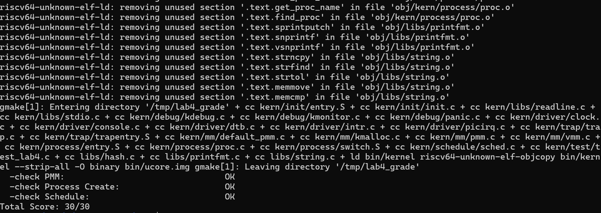

# 操作系统实验报告

## 实验基本信息

| 项目 | 内容 |
|------|------|
| **实验名称** | Lab 4: 进程管理（虚拟内存页操作 / 内核线程 / 调度） |
| **小组成员** | 2412796-杨斯源（组长）、2413628-黄乐仁、2410868-孙锘梵 |
| **完成日期** | 待填写 |

### 小组分工

练习如何分工？

| 成员 | 负责的练习/模块 |
|------|----------------|
| 2412796-杨斯源（组长） | 部分三：进程调度（`cpu_idle` / `schedule` / `proc_run` / `switch_to`）+ 收口与验证 |
| 2413628-黄乐仁 | 部分一：虚拟内存页操作（`page_insert` / `page_remove`）+ 补回 lab2 / lab3 的代码 |
| 2410868-孙锘梵 | 部分二：进程创建及初始化（`alloc_proc` / `proc_init` / `kernel_thread` / `do_fork` / `copy_thread` / `copy_mm`） |

实验报告如何分工？

报告的撰写按上表划分：各功能模块由其负责人撰写对应章节；实验环境、总结与收获及 `prompt.md` 的汇总由部分三负责人负责；最后经统一校对格式与图片引用后提交。

---

## 一、实验目的

本实验的主要目的是：

1. **掌握虚拟内存页的管理接口**：在多级页表框架上实现 `page_insert()` 与 `page_remove()`，理解"页表项内容、物理页引用计数、TLB 状态"三者必须同步。
2. **理解进程控制块与内核线程**：掌握 `struct proc_struct` 各字段的含义，理解 `idleproc` 与 `initproc` 的创建方式差异，以及"复制现有进程"这一创建模型。
3. **掌握线程首次运行的上下文构造**：理解 `kernel_thread → do_fork → copy_thread → forkret → forkrets → __trapret` 这条链路如何让新线程从指定函数入口开始执行。
4. **理解上下文切换与调度**：掌握 `struct context` 为什么只保存被调用者保存寄存器，理解 `switch_to` 的寄存器交换、`proc_run` 的页表切换与 `schedule` 的选线程策略。

---

## 二、实验环境

| 成员 | AI 编程工具 | 底层模型 | 备注 |
|------|------------|---------|------|
| 2412796-杨斯源 | 待填写 | 待填写 | |
| 2413628-黄乐仁 | 待填写 | 待填写 | |
| 2410868-孙锘梵 | DeepSeek Harness（终端/Web Agent） | deepseek-flash | |

**运行环境：**

| 组件 | 版本 / 包名 |
|------|-------------|
| 操作系统 | 待填写 |
| 交叉编译器 | 待填写 |
| 模拟器 | 待填写 |
| 调试器 | 待填写 |

**本实验做的环境适配**（与 lab2/lab3 同源，已提交在 `code/` 内）：

| 位置 | 改动 | 原因 |
|---|---|---|
| `Makefile`、`tools/grade.sh` | `-device loader,file=...,addr=0x80200000` → `-kernel bin/ucore.img` | QEMU ≥ 8 自带 OpenSBI 为 fw_dynamic，跳转地址必须由 QEMU 告知，否则内核不执行 |
| `kern/init/entry.S` | 启动页表补回低 1G 恒等映射 | 打开分页瞬间 PC 仍在物理地址 `0x8020xxxx`，不映射会立即取指页错误 |
| `kern/mm/default_pmm.c` | 删除不存在的 `#include <best_fit_pmm.h>` | 工程中无此头文件，保留则编译失败 |
| `kern/mm/kmalloc.c` | `kva2page(kva)` → `kva2page((void *)kva)` | 新版 GCC 下 `-Wint-conversion` 直接报错 |
| `Makefile` | GDB 命令自动探测 `riscv64-unknown-elf-gdb` / `gdb-multiarch` | apt 仓库没有前者 |
| `tools/grade.sh` | 不设 GDB 断点，跑满固定时间后收串口日志 | 原脚本的断点地址按老平台约定推导，在 riscv64 上不可用 |

---

## 三、实验整体逻辑分析

### 3.1 本章节的逻辑主线

> **待填写（负责人：杨斯源）**
> 建议围绕：本章把"单执行流内核"扩展为"可创建、可调度多线程的内核"。
> 核心链路：`kern_init → pmm_init → vmm_init → proc_init → cpu_idle → schedule → proc_run → switch_to`。
> 前半段准备地址空间与进程管理结构，后半段让第一个可运行线程真正跑起来。

### 3.2 功能的逐步实现

> **待填写（负责人：杨斯源）**
> 建议按"为什么是这个顺序"来写：先补回 lab2/lab3 代码 → 页表映射接口（否则线程地址空间无从谈起）→ PCB 与 idleproc/initproc（没有进程对象就无从调度）→ 调度与切换（有了对象还要让 CPU 真正切过去）→ 验证。

---

## 四、实验内容与实现

### 前置：补回 lab2 与 lab3 的代码

**负责人：** 2413628-黄乐仁、2410868-孙锘梵

实验指导书要求"使用此前设计的提示词生成相应实验代码，并填写到标有 lab2/lab3 注释的位置"。本实验代码中有以下四处：

| 位置 | 需要补回的内容 | 建议负责人 |
|---|---|---|
| `kern/mm/default_pmm.c`（第 6 行附近） | lab2 的 Best-Fit 管理模块（`free_area` + 五个管理函数 + 管理器注册） | 孙锘梵（lab2 写过 Best-Fit） |
| `kern/mm/pmm.c`（第 90 行附近） | lab2 的 `page_init()` | 黄乐仁（lab2 写过 `page_init`） |
| `kern/trap/trap.c`（第 86 行附近） | lab3 的 `interrupt_handler()` / `exception_handler()` | 孙锘梵（lab3 写过两个 handler） |
| `kern/trap/trapentry.S`（第 56、63 行附近） | lab3 的 `RESTORE_ALL` 与 `__alltraps` 调用部分 | 黄乐仁（lab3 写过 `RESTORE_ALL`） |

> **注意**：管理器结构体名在本实验中是 `default_pmm_manager`（见 `kern/mm/default_pmm.h`），
> 但内部函数仍叫 `best_fit_*`、测试函数仍叫 `best_fit_check()`；补回 lab2 代码时只需改名、保留逻辑。
> `basic_check()` 与 `best_fit_check()` 由框架提供，**不得修改或重复实现**。

**补回后的验证：** `make` 能通过、`make qemu` 能启动到 `vmm_init` 的页表检查。

**Best-Fit 补回说明（2410868-孙锘梵）：**

lab4 把 lab2 的 `best_fit_pmm.c` 并进了 `kern/mm/default_pmm.c`，而且**没有** `best_fit_pmm.h`。所以不能把 lab2 的整个文件复制过来：那会重复定义 `basic_check()` 与 `best_fit_check()`，还会多出一个 lab4 根本不引用的 `best_fit_pmm_manager`。补回时只补三部分：

| 补回内容 | 说明 |
|---|---|
| 空闲区结构 | `static free_area_t free_area;`，再用两个宏把 `free_list` / `nr_free` 映射到它的成员；文件里已提供的两个测试函数正是通过这两个名字访问空闲链表，缺了直接编译失败 |
| 五个管理函数 | `best_fit_init`、`best_fit_init_memmap`、`best_fit_alloc_pages`、`best_fit_free_pages`、`best_fit_nr_free_pages`，逻辑与 lab2 完全一致 |
| 管理器注册 | `const struct pmm_manager default_pmm_manager`，`.name = "default_pmm_manager"`、`.check = best_fit_check`；`pmm.c` 第 40 行正是按这个名字取管理器 |

与 First-Fit 的实质差别仍然只在 `best_fit_alloc_pages()` 的选块策略：First-Fit 遇到第一个 `property >= n` 的块就返回；Best-Fit 遍历整条空闲链表，在**所有**满足 `property >= n` 的块里挑 `property` 最小的那一块，把本次分配切剩下的碎片压到最小。释放时则按地址顺序插回链表，并把前、后相邻的空闲块合并，保证空闲链表始终按地址有序。

最终提示词见 [`report/prompt.md`](./prompt.md) 第二节「提示词 0」。

**Trap 两个 handler 补回说明（2410868-孙锘梵）：**

lab4 的 `trap.c` 删掉了 lab3 的 `trap_dispatch()` 与 `trap_in_kernel()`，改成在 `trap()` 末尾直接分流：

```c
void trap(struct trapframe *tf)
{
    if ((intptr_t)tf->cause < 0)
        interrupt_handler(tf);   // 中断
    else
        exception_handler(tf);   // 异常
}
```

这带来一个与 lab3 不同的约束：两个 handler **必须定义在 `trap()` 之前**（骨架的标记处正好在文件中部），否则编译器先见到调用、后见到定义，会报 `implicit declaration of function` 而无法编译。其余逻辑与 lab3 一致——`interrupt_handler` 先剥离 `scause` 最高位再分流，时钟分支必须先 `clock_set_next_event()` 再 `ticks++`，否则时钟只会来一次；`exception_handler` 对非法指令与断点按指令编码推进 `epc`（读 `epc` 处 16 位字，低两位 `0b11` 为 4 字节，否则为 2 字节压缩指令），不能写死 `epc += 4`——lab3 就是在这里踩过 `c.ebreak` 只有 2 字节的坑。

---

### 功能模块一：虚拟内存页操作功能

**负责人：** 2413628-黄乐仁

**需要实现的函数（`kern/mm/pmm.c`）：**

```c
int  page_insert(pde_t *pgdir, struct Page *page, uintptr_t la, uint32_t perm);
void page_remove(pde_t *pgdir, uintptr_t la);
```

**功能说明：** > **待填写（负责人：黄乐仁）**

**注意事项（指导书原文要点）：**

- `page_insert` 不能简单覆盖旧页表项，要区分"原地址已映射到同一物理页"与"已映射到其他物理页"两种情况，分别处理引用计数。
- `get_pte(pgdir, la, 1)` 可能分配中间级页表页，**分配失败必须返回 `-E_NO_MEM` 且不留下半完成映射**。
- `page_remove` 要能处理"目标地址本来就没有映射"的情形，安静返回。
- 所有页表更新后都要 `tlb_invalidate()`，否则测试中会出现"页表已改、翻译还是旧的"。

**验收标准：**

- `[Test PMM] PASS` —— 10 分。

**最终提示词：** > **待填写：见 `report/prompt.md` 第一节「提示词 0」，并在此粘贴定稿原文。**

**实现迭代过程：** > **待填写（负责人：黄乐仁）：记录 AI 生成的 `page_insert`/`page_remove` 出现的问题（引用计数、TLB、失败回滚等）以及如何定位修复。**

---

### 功能模块二：进程创建及初始化功能

**负责人：** 2410868-孙锘梵

**需要实现的函数（`kern/process/proc.c`）：**

```c
static struct proc_struct *alloc_proc(void);
void proc_init(void);
int  kernel_thread(int (*fn)(void *), void *arg, uint32_t clone_flags);
int  do_fork(uint32_t clone_flags, uintptr_t stack, struct trapframe *tf);
static void copy_thread(struct proc_struct *proc, uintptr_t esp, struct trapframe *tf);
static int  copy_mm(uint32_t clone_flags, struct proc_struct *proc);
```

**功能说明：**

本模块负责把内核从「只有一条启动执行流」推进到「有 PCB、能创建内核线程」。六个函数是同一条创建链路上的不同环节：

- `alloc_proc()` 负责 PCB 的**分配与初值**。它从内核堆取一块 `struct proc_struct`，整体清零后只设置少数几个有意义的字段（`state = PROC_UNINIT`、`pid = -1`、`pgdir = boot_pgdir_pa`、`need_resched = 0`），把「未初始化」做成一个可检查的确定状态，而不是让字段停在堆上的随机值。
- `proc_init()` 负责**系统启动时的两条特殊线程**。`idleproc` 直接复用当前启动栈（`bootstack`），pid 固定为 0，随后把 `current` 指向它——此后任何 `do_fork` 都能把 `current` 当作父进程；`initproc` 则通过 `kernel_thread(init_main, "Hello world!!", 0)` 走一遍完整的 fork 流程创建。
- `kernel_thread()` 与 `do_fork()` 负责**通用创建路径**。前者把「入口函数 + 参数」包装成一个 trapframe，并把 `epc` 指向汇编入口 `kernel_thread_entry`；后者完成 PCB、内核栈、地址空间三步资源分配，失败时按逆序回滚，成功后把新 PCB 挂进 `proc_list` 与哈希表并置为可运行。
- `copy_thread()` 负责**首次运行的上下文**。它在内核栈顶伪造一份 trapframe 副本，并把 `struct context` 的 `ra` 设成 `forkret`、`sp` 指向这份 trapframe；新线程第一次被 `switch_to` 换上来时从 `forkret` 进入 `__trapret`，`RESTORE_ALL` 恢复寄存器后 `sret` 跳到 `tf->epc`，于是「第一次运行」看起来就像一次从中断返回。
- `copy_mm()` 在本阶段只做**占位**：所有进程都是内核线程，`mm` 保持 `NULL`。

这条链路的关键在于：新线程的第一次执行不是函数调用，而是一次精心构造的**返回**。`context.ra` 决定切换后先到哪里，`tf->epc` 决定 `sret` 之后到哪里，`tf->gpr.s0/s1` 决定 `kernel_thread_entry` 拿到什么；三者少一个或写错一个，线程要么跑飞，要么在第一次压栈时就崩。

**注意事项（指导书原文要点）：**

- `alloc_proc` 要把 PCB 置于安全的空白状态：**整块清零**再设置少量字段。测试会断言 `tf == NULL`、`parent == NULL`、`mm == NULL`、`runs == 0`、`flags == 0`、`context.ra == 0`，只设置自己关心的字段必然漏项。
- `proc_init` 中 `idleproc` **不是 fork 出来的**，而是直接复用当前执行现场（`bootstack`、`pid = 0`、`need_resched = 1`，`tf` 与 `context.ra` 保持 0）；因此它绝不能走 `kernel_thread`。
- `current = idleproc` 必须在 `kernel_thread(init_main, ...)` **之前**完成；`do_fork` 里的 `proc->parent = current` 与 `copy_mm` 里的 `current->mm` 都依赖它。
- `kernel_thread` 与 `copy_thread` 必须配合 `forkret → forkrets → __trapret` 形成正确的首次运行链路：`context.ra = forkret`、`tf->epc = kernel_thread_entry`、`tf->gpr.s0 = fn`、`tf->gpr.s1 = arg`，且 `context.sp` 指向 `proc->tf`。
- `copy_thread` 中 `esp == 0`（内核线程）时，`tf->gpr.sp` 必须回退到 `(uintptr_t)proc->tf`；若照抄成 `0`，线程第一次压栈就会访问非法地址。
- `do_fork` 的前三步（PCB、内核栈、mm）失败时必须按「内核栈 → PCB」逆序回滚；pid 分配、入哈希表、入进程链表必须在同一个 `local_intr_save/restore` 临界区内完成，成功后 `wakeup_proc`。
- 本阶段 `copy_mm` 只做占位：内核线程 `mm` 为 `NULL`，不做真正的地址空间复制，也不要改 `pgdir`。

**验收标准：**

- `[Test Process Create] PASS` —— 10 分（检查 `idleproc` 的 pid/state/kstack/parent/mm/tf/runs/flags/context，以及 `initproc` 的 pid/parent/context.ra/sp）。

**最终提示词：**

定稿原文如下，全文同时收录于 [`report/prompt.md`](./prompt.md) 第二节「提示词 2」。

````markdown
[PROMPT]

**任务**：修改 `code/kern/process/proc.c`，在 `//LAB4 function2 YOUR CODE` 标记处实现进程创建与初始化模块，包括 `alloc_proc`、`proc_init`、`kernel_thread`、`do_fork`、`copy_thread`、`copy_mm` 六个函数。

**操作要求**：你必须在项目中修改实际文件，而不是只展示代码。只在标记处补全这六个函数，保留文件已有代码：`get_pid`、`forkret`、`hash_proc`、`find_proc`、`setup_kstack`、`put_kstack`、`do_exit`、`init_main` 已经给出，直接调用，不要重写。同文件末尾的 `//LAB4 function3 YOUR CODE` 属于进程调度部分，不要改动。

**输出要求**：直接进行文件操作，使用下面 [RELY]、[GUARANTEE]、[SPECIFICATION] 的信息，以工程真实代码为准，不要引入用户进程、文件系统等本实验之外的功能。

[RELY]

```c
// 数据结构（kern/process/proc.h）
enum proc_state {
    PROC_UNINIT = 0,   // 未初始化
    PROC_SLEEPING,
    PROC_RUNNABLE,     // 可运行（就绪或在跑）
    PROC_ZOMBIE,
};
struct context {          // switch_to 保存/恢复的寄存器
    uintptr_t ra;  uintptr_t sp;
    uintptr_t s0;  uintptr_t s1;  uintptr_t s2;  uintptr_t s3;
    uintptr_t s4;  uintptr_t s5;  uintptr_t s6;  uintptr_t s7;
    uintptr_t s8;  uintptr_t s9;  uintptr_t s10; uintptr_t s11;
};
#define PROC_NAME_LEN 15
#define MAX_PROCESS 4096
#define MAX_PID (MAX_PROCESS * 2)

struct proc_struct {
    enum proc_state state;         // 进程状态
    int pid;                       // 进程 ID
    int runs;                      // 已运行次数
    uintptr_t kstack;              // 内核栈基址
    volatile bool need_resched;    // 是否需要被换下 CPU
    struct proc_struct *parent;    // 父进程
    struct mm_struct *mm;          // 内存管理信息（本阶段为 NULL）
    struct context context;        // 切换上下文
    struct trapframe *tf;          // 中断帧
    uintptr_t pgdir;               // 页目录基址（物理地址）
    uint32_t flags;                // 进程标志
    char name[PROC_NAME_LEN + 1];  // 进程名
    list_entry_t list_link;        // 进程链表节点
    list_entry_t hash_link;        // 进程哈希表节点
};

// trapframe（kern/trap/trap.h）：gpr 含 zero/ra/sp/.../s0/s1/a0/...，
// 其后是 status、epc、badvaddr、cause。

// 常量与全局变量
extern char bootstack[], bootstacktop[];   // kern/init/entry.S 的启动栈
#define KSTACKPAGE 2                        // 内核栈页数
#define KSTACKSIZE (KSTACKPAGE * PGSIZE)    // 内核栈大小 = 8KB
#define HASH_SHIFT 10
#define HASH_LIST_SIZE (1 << HASH_SHIFT)   // = 1024
extern list_entry_t proc_list;
extern struct proc_struct *idleproc, *initproc, *current;
static list_entry_t hash_list[HASH_LIST_SIZE];
static int nr_process;                      // 已用 PCB 数
extern uintptr_t boot_pgdir_pa;             // 页目录物理地址（kern/mm/pmm.h）

// 寄存器常量（libs/riscv.h）
#define SSTATUS_SIE  0x00000002
#define SSTATUS_SPIE 0x00000020
#define SSTATUS_SPP  0x00000100
read_csr(sstatus) / write_csr(sstatus, val) / set_csr(sstatus, bit)

// 仅内核线程相关：entry.S 的 kernel_thread_entry 依次执行
//   move a0, s1;  jalr s0;  jal do_exit
// 即 s0 = 入口函数、s1 = 参数；forkrets(tf) 会走 __trapret → RESTORE_ALL → sret。

// 文件内已给出的辅助函数
static int get_pid(void);                       // 从 1 开始循环分配 pid
static void forkret(void);                      // forkrets(current->tf)
static void hash_proc(struct proc_struct *p);
static struct proc_struct *find_proc(int pid);
static int setup_kstack(struct proc_struct *p);// alloc_pages(KSTACKPAGE)，成功返回 0
static void put_kstack(struct proc_struct *p);
void wakeup_proc(struct proc_struct *proc);     // sched.c，置 PROC_RUNNABLE
char *set_proc_name(struct proc_struct *p, const char *name);
void *kmalloc(size_t n);  void kfree(void *objp);
#define local_intr_save(x)   // 关中断并把原状态存入 x
#define local_intr_restore(x)// 恢复中断状态
// 错误码（libs/error.h）：E_NO_MEM、E_NO_FREE_PROC，使用时取负
```

[GUARANTEE]

必须实现或修改的接口：
```c
static struct proc_struct *alloc_proc(void);
static int copy_mm(uint32_t clone_flags, struct proc_struct *proc);
static void copy_thread(struct proc_struct *proc, uintptr_t esp, struct trapframe *tf);
int kernel_thread(int (*fn)(void *), void *arg, uint32_t clone_flags);
void proc_init(void);
int do_fork(uint32_t clone_flags, uintptr_t stack, struct trapframe *tf);
```

你可以根据需要添加 static 辅助函数或模块内部宏，但不要改变上述签名，也不要新增全局变量。

[SPECIFICATION]

## alloc_proc
**Pre-Condition**：
- `kmalloc` 已初始化可用。

**Post-Condition**：
- 成功时返回一个所有字段均为确定初值的 PCB；失败时返回 `NULL`。

**Case 1（kmalloc 失败）**：
- 返回 `NULL`，不修改任何全局状态。

**Case 2（分配成功）**：
- 整块清零后设置：`state = PROC_UNINIT`、`pid = -1`、`pgdir = boot_pgdir_pa`、`need_resched = 0`；其余字段（`parent`、`mm`、`tf`、`runs`、`flags`、`kstack`、`context`、`name`、两个链表节点）保持零值。

**Requirements**：
- 必须整体清零而不是逐字段挑着赋值：测试会断言 `tf == NULL`、`parent == NULL`、`mm == NULL`、`runs == 0`、`flags == 0`、`context.ra == 0`。
- `pgdir` 存的是页目录**物理地址**（`proc_run` 要写进 satp），不能存虚拟地址。

## proc_init
**Pre-Condition**：
- 内核已进入 `kern_init`；`kmalloc_init`、`pmm_init` 已完成；`current` 尚无效。

**Post-Condition**：
- `proc_list` 与 `hash_list` 的 1024 个桶全部初始化；`idleproc` 为 pid 0、`PROC_RUNNABLE`、`kstack == bootstack`、`need_resched == 1`、名字 `"idle"`；`current == idleproc`；`initproc` 为 pid 1、父进程 `idleproc`、`PROC_RUNNABLE`、名字 `"init"`；`nr_process == 2`。

**Case 1（创建 idleproc）**：
- 分配 PCB 并设置上述字段，`nr_process` 置 1，把 `current` 指向它。

**Case 2（创建 initproc）**：
- 调用 `kernel_thread(init_main, "Hello world!!", 0)` 创建；返回 pid 小于等于 0 时 `panic`；随后用 `find_proc(pid)` 取回 PCB 并命名为 `"init"`。

**Requirements**：
- `idleproc` **不能**通过 `kernel_thread`/`do_fork` 创建：它直接复用启动栈，`tf` 与 `context.ra` 必须保持 0（测试断言 `idleproc->tf == NULL`、`context.ra == 0`）。
- `current = idleproc` 必须在调用 `kernel_thread` **之前**完成，否则 `do_fork` 里 `proc->parent = current` 会把 initproc 的父进程设错。
- `nr_process` 要在创建 idleproc 后置 1，之后由 `do_fork` 自增。
- 测试会在 `proc_init` 返回后检查：`current == idleproc`、`idleproc->pid == 0`、`idleproc->kstack == (uintptr_t)bootstack`、`idleproc->state == PROC_RUNNABLE`、`initproc->pid == 1`、`initproc->parent == idleproc`、`initproc->state == PROC_RUNNABLE`。

## kernel_thread
**Pre-Condition**：
- `kernel_thread_entry` 已链接进内核；`clone_flags` 由调用者给出（如 0）。

**Post-Condition**：
- 成功时新建一个内核线程，处于 `PROC_RUNNABLE`；它第一次被调度时从 `fn(arg)` 开始执行，运行在 S 态且开中断。

**Case 1（do_fork 成功）**：
- 返回新线程的 pid（大于 0）。

**Case 2（do_fork 失败）**：
- 返回负错误码，不残留 PCB 或内核栈。

**Requirements**：
- 必须先构造一个全零的 `struct trapframe` 局部变量，再填：`gpr.s0 = (uintptr_t)fn`、`gpr.s1 = (uintptr_t)arg`、`epc = (uintptr_t)kernel_thread_entry`。这与 `kernel_thread_entry` 的 `move a0, s1; jalr s0` 严格对应，寄存器不能换。
- `status` 要置 `SSTATUS_SPP`（sret 后回到 S 态）与 `SSTATUS_SPIE`（sret 后开中断），并清 `SSTATUS_SIE`（sret 前保持关中断）。
- 不要直接调用 `fn(arg)`，必须通过 `do_fork` 走调度器。

## copy_thread
**Pre-Condition**：
- `proc` 已分配好内核栈 `kstack`；`tf` 是调用者提供的 trapframe 模板；`esp` 为期望的用户栈顶（内核线程为 0）。

**Post-Condition**：
- `proc->tf` 指向其内核栈顶部的 trapframe 副本；`proc` 首次被 `switch_to` 后，经 `forkret → __trapret → sret` 跳到 `tf->epc` 开始执行。

**Case 1（`esp != 0`，指定了栈）**：
- `gpr.sp = esp`。

**Case 2（`esp == 0`，内核线程）**：
- `gpr.sp = (uintptr_t)proc->tf`，即让它从自己的内核栈顶开始压栈。

**Requirements**：
- `proc->tf` 必须放在 `kstack + KSTACKSIZE` 之下（栈顶往下第一个 trapframe 的位置），不能越过栈顶。
- `context.ra` 必须是 `forkret`，不能写成 `kernel_thread_entry`：入口地址是通过 `sret` 从 `tf->epc` 跳过去的，`ra` 只负责第一次 `switch_to` 的返回点。
- `context.sp` 指向 `proc->tf`；`gpr.a0` 置 0，作为子线程的“返回值”。
- `esp == 0` 时必须回退到内核栈顶：若直接令 `gpr.sp = 0`，线程第一次压栈就会访问非法地址。

## copy_mm
**Pre-Condition**：
- `current` 指向当前进程。

**Post-Condition**：
- 新进程的 `mm` 字段被正确设置；本实验所有进程都是内核线程。

**Case 1（`current->mm == NULL`）**：
- 置 `proc->mm = NULL`，返回 0。

**Case 2（`current->mm != NULL`，用户进程）**：
- `panic`，lab4 不支持用户进程地址空间复制。

**Requirements**：
- 保持该签名与调用位置，便于 lab5 扩展；不要复制页表，也不要修改 `pgdir`。

## do_fork
**Pre-Condition**：
- `current` 指向当前进程；`clone_flags`、`stack`、`tf` 由调用者给出。

**Post-Condition**：
- 成功时新 PCB 已挂入 `proc_list` 和哈希表，`nr_process` 加一，状态为 `PROC_RUNNABLE`，返回其 pid；失败时返回负错误码，且不残留 PCB 或内核栈。

**Case 1（`nr_process >= MAX_PROCESS`）**：
- 返回 `-E_NO_FREE_PROC`。

**Case 2（`alloc_proc` 失败）**：
- 返回 `-E_NO_MEM`。

**Case 3（`setup_kstack` 失败）**：
- 释放 PCB 后返回 `-E_NO_MEM`。

**Case 4（`copy_mm` 失败）**：
- 释放内核栈和 PCB 后返回相应错误码。

**Case 5（全部成功）**：
- 设 `proc->parent = current`，调用 `copy_thread`，然后在关中断临界区内完成 `pid = get_pid()`、`hash_proc(proc)`、`list_add(&proc_list, &proc->list_link)`、`nr_process++`；退出临界区后 `wakeup_proc(proc)`，返回 `proc->pid`。

**Requirements**：
- pid 分配、入哈希表、入进程链表必须在同一个 `local_intr_save` 临界区内完成，否则并发 fork 可能拿到重复 pid。
- 错误路径按“内核栈 → PCB”的逆序回滚，不能漏也不能重复释放。
- 返回前新进程必须已置为 `PROC_RUNNABLE`（`wakeup_proc`），否则调度器永远不会选中它。
````

**实现迭代过程：**

**一、先把测试断言翻译成约束**

`tools/test_lab4.c` 的 `test_lab4_process_create()` 是在 `proc_init()` 返回后立刻执行的，逐字段检查 `idleproc` 与 `initproc`。这一步实际上决定了实现方式：`idleproc->tf == NULL` 与 `context.ra == 0` 意味着 idleproc 不能走 fork；`initproc->parent == idleproc` 意味着 `current` 必须先赋值；`initproc->context.ra != 0`、`context.sp != 0` 意味着 `copy_thread` 必须真的把 `context` 填起来。六个函数还没动笔，这些断言已经把「哪些字段必须是什么」定死了。

**二、按创建链路的顺序分步实现**

1. `alloc_proc`：`kmalloc` + `memset` 整块清零，再设四个字段；单独编译 `make obj/kern/process/proc.o` 确认无警告。
2. `copy_mm`、`copy_thread`：先把被 `do_fork` 调用的两个环节写好——一个决定地址空间，一个决定首次上下文。
3. `kernel_thread`：只构造 trapframe，不直接调用 `fn(arg)`，统一交给 `do_fork` 走调度器。
4. `do_fork`：资源分配 → 失败回滚标签 → 临界区内入表 → `wakeup_proc`。
5. `proc_init`：最后写，因为它依赖前面所有函数；先建 idleproc 并赋 `current`，再 `kernel_thread` 建 initproc。

**三、四个必须写死的细节**

1. **PCB 必须整块清零。** 逐字段赋值时，`tf`、`parent`、`mm`、`runs`、`flags`、`context` 这些「暂时用不到」的字段会保留 `kmalloc` 返回的堆内容，而测试恰好逐个断言它们为 0 / NULL。用 `memset(proc, 0, sizeof(*proc))` 一次解决，也顺带保证 `list_link` / `hash_link` 处于可安全 `list_add` 的状态（两个指针都指向自己）。
2. **`current` 必须先于 `kernel_thread`。** `do_fork` 里要写 `proc->parent = current`，`copy_mm` 里要读 `current->mm`；若先创建 initproc 再赋 `current`，轻则父进程为空，重则解引用空指针。
3. **`context.ra` 是 `forkret`，不是 `kernel_thread_entry`。** `switch_to` 只恢复 `context` 里的 14 个寄存器，`s0` / `s1` 并不会被自动设成 `fn` / `arg`；真正的入口靠 `forkret → forkrets` 把 `sp` 切到 `proc->tf`，再由 `RESTORE_ALL` 从 trapframe 恢复 `s0` / `s1`，最后 `sret` 跳到 `tf->epc`。把 `ra` 写成 `kernel_thread_entry` 会跳过整段 trapframe 恢复，线程拿到的是切换前的残留寄存器值。
4. **`esp == 0` 时 `gpr.sp` 必须回退到内核栈顶。** 内核线程没有用户栈，`copy_thread` 收到的 `esp` 是 0；若直接写 `tf->gpr.sp = esp`，`RESTORE_ALL` 会把 `sp` 恢复成 0，`sret` 之后第一次压栈就写向地址 0。正确做法是 `gpr.sp = (uintptr_t)proc->tf`，让它从自己的 trapframe 顶部开始压栈。

**四、一次真实的弯路：把 lab3 的文件整个搬过来**

补回 Best-Fit 时最直接的想法是「lab3 的 `best_fit_pmm.c` 已经是一份完整实现，整体复制成 `default_pmm.c` 就行」。实际编译立刻失败，而且两侧都会失败：

- **带着测试函数搬**：lab4 的 `default_pmm.c` 里已经有框架提供的 `basic_check()` 与 `best_fit_check()`，再带一份就是重复定义；
- **只搬管理器**：lab4 没有 `best_fit_pmm.h`，`pmm.c` 只认 `default_pmm_manager`，搬过来的 `best_fit_pmm_manager` 没有任何地方引用；而如果把测试函数连同宏一起删掉，`free_list` / `nr_free` 又会立刻变成 `undeclared`——这正是骨架原状下 `default_pmm.c` 的编译错误。

最后的做法是「只搬中间那一段」：保留 lab4 的两个测试函数不动，只插入 `free_area` + 两个宏 + 五个管理函数，再把管理器结构体改名为 `default_pmm_manager`、`.check` 指向框架的 `best_fit_check`。补回 lab3 的两个 handler 时同理：lab3 的 `trap_dispatch()` 与 `trap_in_kernel()` 在 lab4 已经被删掉，照搬会多出两个无人调用的函数；而 handler 若按 lab3 的位置写在 `trap()` 之后，编译器先见到调用后见到定义，直接报 `implicit declaration of function 'interrupt_handler'`——这条错误在补回之前的基线构建里就能复现。

**教训**：补回旧代码不是文件级复制，而是接口级对齐。先看新骨架已经提供了什么（测试函数、头文件、管理器名字、调用顺序），再决定搬哪几段；否则不是重复定义就是缺符号。

**五、阶段性验证与遗留**

`make obj/kern/process/proc.o` 单独编译通过（`-std=gnu99 -Wall -Wno-unused`，无警告）；全量 `make -k` 目前只剩 `kern/mm/pmm.c:149: implicit declaration of function 'page_init'`——那是部分一尚未补回的 `page_init()`，另外部分三的 `RESTORE_ALL` / `sched.c` / `switch.S` 也还是空的。因此本模块的运行时验证（`[Test Process Create] PASS`）要等三部分合并后统一做；在此之前，六个函数的正确性靠「逐条对照测试断言 + 手工推演首次运行链路」保证。

---

### 功能模块三：进程调度

**负责人：** 2412796-杨斯源（组长）

**需要实现的函数：**

```c
void cpu_idle(void);                                  // kern/process/proc.c
void schedule(void);                                  // kern/schedule/sched.c
void proc_run(struct proc_struct *proc);              // kern/process/proc.c
void switch_to(struct context *from, struct context *to);  // kern/process/switch.S
```

**功能说明：** > **待填写（负责人：杨斯源）**

**注意事项（指导书原文要点）：**

- `schedule` 与 `proc_run` 的临界区必须关中断（`local_intr_save/restore`），否则 `current`、页表与实际执行现场可能不一致。
- 选线程三种情形：当前不是 idleproc → 从下一个开始找（轮转）；当前是 idleproc → 从头找；都找不到 → 退回 idleproc。
- `proc_run` 要更新 `current`、`write_csr(satp, ...)` 切页表、`flush_tlb()`，再 `switch_to`。
- **`libs/riscv.h` 的 `lsatp()` 是 Sv32 遗留，无法表达 Sv39 的 satp，不可使用**；参照 `kern/mm/pmm.c` 的 `enable_paging()` 写法。
- `switch_to` 只交换 `struct context` 里的 14 个寄存器（`ra`/`sp`/`s0..s11`），不做策略判断；新线程第一次运行靠 `context.ra = forkret`。

**验收标准：**

- `[Test Schedule] PASS` —— 10 分；另需输出 `this initproc, pid = 1, name = "init"`、`To U: "Hello world!!".`、`To U: "en.., Bye, Bye. :)"`。

**最终提示词：** > **待填写：见 `report/prompt.md` 第三节「提示词 0」，并在此粘贴定稿原文。**

**实现迭代过程：** > **待填写（负责人：杨斯源）：记录 `switch_to` 汇编、satp 切换、调度死循环等问题与解决过程。**

---

### 扩展练习（Challenge，思考题）

> **待填写（负责人：全体，由部分三汇总）**
>
> 1. 说明 `local_intr_save(intr_flag); ... local_intr_restore(intr_flag);` 是如何实现开关中断的。
> 2. `get_pte()` 中的两段相似代码：结合 sv32 / sv39 / sv48 的异同，解释它们为什么如此相像。
> 3. `get_pte()` 把"查找页表项"和"分配页表页"合并在一个函数里，这种写法好不好？有没有必要拆开？

---

## 五、测试与验证

**编译与运行（`make qemu`）：**

> **待填写（负责人：杨斯源）**：描述启动过程中能看到的关键输出（内存管理信息、`check_pgdir() succeeded!`、initproc 的三行输出等）。


**自动评分（`make grade`）：**

| 测试 | 检查内容 | 分值 | 结果 |
|---|---|---|---|
| Test PMM | 页表映射建立/撤销与引用计数 | 10 | 待填写 |
| Test Process Create | `idleproc` / `initproc` 的 PCB 字段 | 10 | 待填写 |
| Test Schedule | 线程创建、轮转调度、切换执行 | 10 | 待填写 |
| **总分** | | **30** | 待填写 |



---

## 六、实验总结与收获

### 对操作系统的理解

**1. 本实验中重要的知识点，及与 OS 原理中对应知识点的关系**

> **待填写（负责人：杨斯源）**：建议覆盖——虚拟内存与地址空间、页表项与 TLB、进程控制块、上下文（caller-saved / callee-saved）、线程与进程的区别、调度策略（FIFO/轮转）、原子性与临界区。

**2. OS 原理中很重要、但本实验没有对应上的知识点**

> **待填写（负责人：杨斯源）**：建议覆盖——进程阻塞与唤醒的真实使用、优先级调度、多核与 IPI、用户态进程与系统调用、缺页异常与按需分页、进程间通信、内存映射文件。

### AI 协作开发的经验

> **待填写（负责人：杨斯源）**：结合本实验真实经过写（首次运行链路难描述、汇编上下文、`satp` 写法、调试手段等）。

---

## 七、提交前自检

- [ ] 四处 lab2/lab3 代码已补回，五处 `LAB4 functionN YOUR CODE` 已填并替换为学号
- [ ] `SAVE_ALL`、`struct trapframe`、`trap()` 签名未被修改；未改动框架提供的测试函数
- [ ] `make` 在 `-Werror` 下无警告通过，`make grade` 30/30
- [ ] 全文无"待填写"；每个功能模块都有「最终提示词」与「实现迭代过程」
- [ ] `prompt.md` 三节齐全，迭代记录表已填
- [ ] `images/` 下截图齐全且为真实截图，路径为相对路径
- [ ] 成果在 `lab4` 分支，根目录只有 `code/` 与 `report/`
