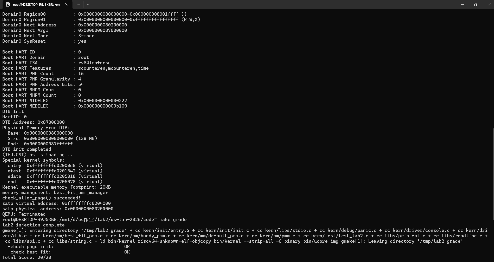
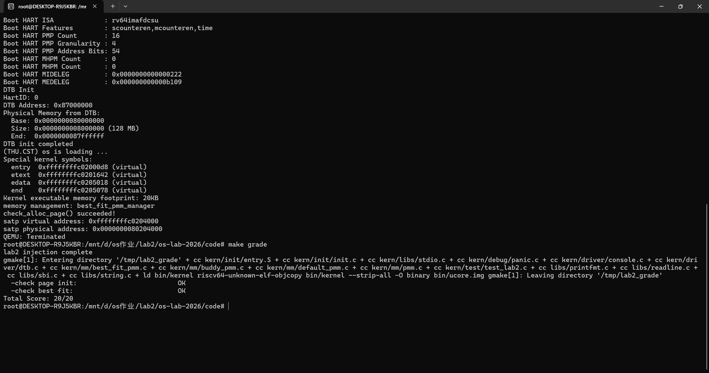

# 操作系统实验报告

## 实验基本信息

| 项目 | 内容 |
|------|------|
| **实验名称** | Lab 2: 物理内存和页表 |
| **小组成员** | 2412796-杨斯源（组长）、2413628-黄乐仁、2410868-孙锘梵 |
| **完成日期** | 2026-10-22 |

### 小组分工

练习如何分工？

| 成员 | 负责的练习/模块 |
|------|----------------|
| 2412796-杨斯源（组长） | 部分三：伙伴系统与收口（Buddy System 模块 + 自研测试 + 报告汇总） |
| 2413628-黄乐仁 | 部分一：物理内存初始化（`page_init()` + Challenge 思考题） |
| 2410868-孙锘梵 | 部分二：页面分配算法（First-Fit 思考题 + Best-Fit 实现） |

实验报告如何分工？

报告的撰写按上表划分：各功能模块由其负责人撰写对应章节；实验环境、总结与收获及 `prompt.md` 的汇总由部分三负责人负责；最后经统一校对格式与图片引用后提交。

---

## 一、实验目的

本实验的主要目的是：

1. **理解物理内存的管理方法**：掌握操作系统如何发现可用物理内存、如何用页描述符组织物理页、以及如何把空闲页交给内存管理器。
2. **理解页面分配算法**：通过阅读 First-Fit 实现掌握连续物理内存分配的基本流程，并自己实现 Best-Fit 与 Buddy System 两种分配算法。
3. **理解页表的建立和使用方法**：理解 RISC-V Sv39 分页机制，掌握内核从物理地址 `0x80200000` 被搬到高虚拟地址 `0xFFFFFFFFC0200000` 后，虚拟地址与物理地址如何通过页表相互转换。
4. **学习用 AI 辅助开发操作系统核心功能**：按 lab0.5 的四段式框架设计提示词，让 AI 生成物理内存管理模块，并对生成结果做验证与迭代。

---

## 二、实验环境

| 成员 | AI 编程工具 | 底层模型 | 备注 |
|------|------------|---------|------|
| 2412796-杨斯源 | Claude Code（终端 Agent） | DeepSeek-V4-Flash | |
| 2413628-黄乐仁 | Claude Code（终端 agent） | DeepSeek V4 Flash | |
| 2410868-孙锘梵 | Cline（VS Code 插件） | DeepSeek V4 Pro | |

**运行环境：**

| 组件 | 版本 / 包名 |
|------|-------------|
| 操作系统 | Ubuntu 24.04.5 LTS（WSL2） |
| 交叉编译器 | `riscv64-unknown-elf-gcc` 15.1.0 |
| 二进制工具 | `riscv64-unknown-elf-ld` / `objcopy` / `objdump` |
| 模拟器 | `qemu-system-riscv64` 8.2.2（apt 包 `qemu-system-misc`，自带 OpenSBI v1.3） |
| 调试器 | `riscv64-unknown-elf-gdb` 16.3.90 |

**说明：**

- **AI 编程工具**：指具体使用的终端工具、编辑器插件、桌面应用或浏览器界面
- **底层模型**：指该工具使用的大语言模型及版本

---

## 三、实验整体逻辑分析

### 3.1 本章节的逻辑主线

本章围绕“操作系统怎样管理物理内存、怎样建立虚拟地址到物理地址的映射”展开，最终交付一个能够**识别、组织并分配**可用物理内存、并且**运行在开启分页的虚拟地址空间**中的内核。

与 lab1 相比，本章完成了两个关键跨越：一是内核**从物理地址搬到高虚拟地址**（`0x80200000` → `0xFFFFFFFFC0200000`），由启动页表和 Sv39 分页机制完成；二是**从“完全没有内存管理”到“有一套完整的物理内存管理子系统”**。

整章要解决的问题可以拆成三个递进的子问题：

1. **内存有多少**——从设备树（DTB）探测物理内存范围；
2. **怎么描述内存**——为每个物理页建立 `struct Page` 描述符，并排除内核镜像与描述符数组自身占用；
3. **怎么分配内存**——把空闲页交给 `pmm_manager`，再实现不同的分配算法来管理它们。

这些问题恰好对应实现链 `pmm_init() → init_pmm_manager() → page_init() → init_memmap() → alloc_pages()/free_pages()`：前面的每一步都在为下一步准备输入。

### 3.2 功能的逐步实现

本章按如下顺序逐步实现，每一步都为下一步提供必要前提：

1. **先把内核搬到高虚拟地址**（`tools/kernel.ld` 的 `BASE_ADDRESS` 改为 `0xFFFFFFFFC0200000`）。
   → 为什么必须先做？地址相关的代码在**链接时**就固化成绝对地址了，链接脚本必须先定；同时它也决定了此后所有地址转换所使用的偏移量 `PHYSICAL_MEMORY_OFFSET`。

2. **再建立启动页表并开启 Sv39**（`kern/init/entry.S`）。
   → 为什么接着做？内核要在分页模式下运行，而页表必须在跳转到高地址之前建好。这里还必须在页表里**保留一段低地址恒等映射**：`csrw satp` 之后、跳转到高地址之前，引导代码仍运行在低地址 `0x80200000` 附近，若该区间未映射会立刻取指缺页（本实验实际踩到了这一点：原页表只映射了第 511 项即高 1G，低地址取指会立刻缺页，修复方式是补上第 2 项低 1G 恒等映射，详见第六节）。

3. **从设备树探测物理内存范围**（`dtb_init()` → `get_memory_base()` / `get_memory_size()`）。
   → 为什么然后做？OS 事先并不知道硬件的内存布局；OpenSBI 通过 `a1` 把设备树地址交给内核，内核解析出可用物理内存区间，才谈得上管理。

4. **建立 Page 描述符数组并划出可用区**（`page_init()`）。
   → 为什么接着做？要给每个物理页一个“身份证”。关键是必须把**内核镜像**和**描述符数组自身**所占的页排除在空闲区之外，否则分配器会把正在运行的内核本身分配出去。

5. **把空闲页交给管理器**（`init_memmap()`）。
   → 为什么然后做？这是管理器的输入：物理内存管理子系统从此有了可分配的资源。

6. **实现并切换分配算法**（First-Fit → Best-Fit → Buddy）。
   → 为什么最后做？不同算法解决不同的碎片问题：First-Fit 简单但容易切碎大块；Best-Fit 尽量选最贴合的块以减少浪费；Buddy 用 2 的幂块加伙伴合并，在分配速度与碎片控制之间取得平衡。

---

## 四、实验内容与实现

### 功能模块一：物理内存初始化

**负责人：** 2413628-黄乐仁

#### 前置修复：entry.S 启动页表补充低 1G 恒等映射

**背景：** 内核最终要运行在高虚拟地址（`0xffffffffc0200000`），但 OpenSBI 只会按链接脚本指定的物理地址 `0x80200000` 载入内核镜像并跳转到 `kern_entry`，此时分页尚未开启。因此 `entry.S` 必须在跳转到高地址的 `kern_init` 之前，先建好 Sv39 三级页表、写 `satp` 开启分页，再显式 `jr` 到高地址——这是本模块（乃至整个内核）能否跑起来的前提。

**问题：** 初版 `boot_page_table_sv39` 只填了第 511 项（`0xffffffffc0000000 → 0x80000000`），前 511 项全为 0。但 `csrw satp` 之后、`jr t0` 之前的引导代码仍运行在低地址（`0x80200000` 附近）：`csrw satp` 这条指令本身在低地址，紧随其后的 `sfence.vma`、`lui sp` 等指令的取指也都在低地址。分页生效后低地址却没有任何映射（V=0），取指立刻触发 `exec_page_fault`，内核在进入 `kern_init` 之前就崩溃，`make grade` 恒为 0/20。

**修复：** 补上第 2 项**低 1G 恒等映射**（`0x80000000 → 0x80000000`，PPN=`0x80000`、标志位 `VRWXAD`），让 `csrw satp` 之后到跳转高地址之前的引导代码仍能正常取指执行；等 `jr t0` 进入高地址 `kern_init` 后，内核便完全切到第 511 项的高 1G 映射上运行。

**结果：** 修复后内核正常启动，`page_init()` 得以在真实内核里运行验证，`make grade` 达到 20/20。

---

#### 任务一：实现物理内存探测与页描述符初始化功能

**需要实现/修改的函数：**

```c
static void page_init(void);   // kern/mm/pmm.c
```

**功能说明：**

根据设备树提供的物理内存信息建立可管理物理页的描述符布局，并把排除 OpenSBI、内核镜像与描述符数组占用空间后的完整空闲页面交给当前 `pmm_manager` 管理，为后续页面分配提供正确的初始状态。`page_init()` 不接收参数也不返回结果，由 `pmm_init()` 调用。

**实现约束：**

- 必须区分**虚拟地址、物理地址、物理页号、Page 描述符地址**四者
- 正确处理可管理上界与页面对齐
- 确保内核镜像与描述符数组**不会进入空闲区**
- 设备树信息无效时应终止初始化；**没有可用完整页面时不得调用 `init_memmap()`**

**验收标准（来自 `tools/test_lab2.c`，共 8 条）：**

1. `va_pa_offset == PHYSICAL_MEMORY_OFFSET`
2. 设备树报告了有效的物理内存范围（`get_memory_base()` / `get_memory_size()` 均非 0）
3. `npage == PPN(mem_base + mem_size)` 且 `npage > nbase`
4. `pages` 非空、按 `PGSIZE` 对齐、且位于内核 `end`（向上取整到页）之后
5. 空闲页数在 `(0, npage - nbase]` 区间内
6. 内核镜像尾页（`PADDR(end)` 对应的页）必须处于 `PageReserved` 状态
7. 页描述符数组自身所占的页也必须处于 `PageReserved` 状态
8. `page2pa()` / `pa2page()` 往返转换正确

**最终提示词：**

完整文本见 [`report/prompt.md`](./prompt.md) 第一节「部分一：物理内存初始化」。这份提示词的设计要点：

- **[PROMPT]** 明确目标文件与函数签名（`kern/mm/pmm.c` 的 `page_init()`），要求**必须修改真实文件**、且只改这一个文件；并把“`YOUR CODE` 替换为学号、保留 `//lab2` 注释”写进任务本身。
- **[RELY]** 只给与 `page_init` 直接相关的事实：地址常量（`PHYSICAL_MEMORY_OFFSET` / `KERNEL_BEGIN_PADDR` / `PHYSICAL_MEMORY_END`）、页与页号宏（`PGSIZE` / `PGSHIFT` / `PPN` / `ROUNDUP`）、全局符号（`pages` / `npage` / `nbase` / `va_pa_offset`）、设备树接口（`get_memory_base()` / `get_memory_size()`）、`struct Page` 与 `SetPageReserved`、地址转换（`PADDR` / `pa2page` / `page2pa`）、链接符号 `end`。
- **[GUARANTEE]** 只交付一个函数，避免 AI 顺手改动别的代码。
- **[SPECIFICATION]** 按**执行顺序**列出 7 条 Requirements，并把 `tools/test_lab2.c` 的 **8 条验收标准原样列出**——让“要交付什么”和“怎么判定”成为同一份东西。
- **全局约束**：`-Werror` 下无警告、内核无 libc，以及“注意区分**虚拟地址 / 物理地址 / 页号 / Page 指针**四者”这条最容易出错的地方。

**实现迭代过程：**

**第一轮：生成初版。** 让 AI 参考经典 ucore 的 `page_init()` 生成代码。初版照搬 x86 版思路，用 `e820map` 结构探测物理内存，但本实验是 RISC-V 移植、没有 `e820map`：内存范围由 `dtb_init()` 解析设备树后经 `get_memory_base()/get_memory_size()` 提供，虚实映射偏移是 `PHYSICAL_MEMORY_OFFSET`（`0xFFFFFFFF40000000`）。因此第一版无法直接使用。

**第二轮：按 RISC-V 平台重写，并逐条对照 8 条验收。** 修正提示词，明确用设备树接口与平台常量，实现顺序为：设 `va_pa_offset` → 取 `mem_base/mem_size`（无效则 `panic`）→ 算 `npage = PPN(mem_end)` → 把 `pages` 放到内核 `end` 之后按页对齐 → 全量 `SetPageReserved` → 从 `freemem`（pages 数组末尾，需 `PADDR`）之后 `init_memmap` 释放空闲页。过程中重点排除了两处 bug：

1. **地址类型混淆**：`end` 是内核**虚拟地址**，直接当物理地址用会算错；必须先 `ROUNDUP((uintptr_t)end, PGSIZE)` 再 `PADDR` 转物理地址。`freemem` 同样是"pages 数组末尾"的虚拟地址，`PADDR` 之后才能与物理的 `mem_end` 比较。
2. **遗漏保留区**：不能只保留内核镜像占用的页，**页描述符数组自身占用的页也必须 `PageReserved`**，否则数组所在页会被当作空闲页交给管理器。实现里用"先全部 `SetPageReserved`、再从 `freemem` 之后释放"一次性覆盖这两块保留区，正好同时满足验收第 6、7 条。

**第三轮：编译与验收收敛。** 修正后在 `-Werror` 下编译通过、零警告，整棵树（含部分二的 `best_fit_pmm.c`、部分三的 `buddy_pmm.c`）成功链接；逐条核对 `tools/test_lab2.c` 的 8 条断言（`va_pa_offset`、`npage`、`pages` 对齐、空闲页数区间、内核尾页与数组页均 reserved、`page2pa`/`pa2page` 往返），最终 `make grade` 中 `[Test 1] Page Init: PASS`。

---

#### 拓展任务 Challenge：硬件的可用物理内存范围的获取方法（思考题）

**负责人：** 2413628-黄乐仁

**题目：** 如果 OS 无法提前知道当前硬件的可用物理内存范围，请问你有何办法让 OS 获取可用物理内存范围？

**解答：**

OS 在启动早期并不知道硬件内存布局，需要一套机制来"发现"可用内存。常见方案有以下几类：

**1. 依赖固件 / 引导程序传递（本实验采用的方式）**

RISC-V 平台下，OpenSBI 作为运行在 M 态的固件，在跳转到内核前会把设备树（DTB）的物理地址通过寄存器 `a1` 传给内核（`a0` 传 hartid）。内核解析 DTB 中 `memory` 节点的 `reg` 属性（起始地址 + 大小），即可得到可用物理内存范围。本实验正是这条路：`kern_init()` 先调 `dtb_init()` 解析设备树，`page_init()` 再读 `get_memory_base()/get_memory_size()` 得到 `0x80000000 + 128 MiB`。

- **适用场景**：嵌入式、RISC-V/ARM 等硬件差异大、没有统一 BIOS 的平台，由固件统一描述硬件。
- **局限**：依赖引导固件与内核之间的传递协议；DTB 内容由平台固件生成，若固件描述错误，内核无法自行纠偏。

**2. 固件提供的查询接口（SBI memory 调用）**

SBI 规范提供了内存相关的 ecall 接口（以及通过设备树/ACPI 等固件接口查询内存），内核可主动向 M 态固件发起查询。

- **适用场景**：有统一固件抽象层的平台。
- **局限**：能力受固件实现限制，不同 SBI 版本接口差异较大，可移植性一般。

**3. 平台固件表（ACPI E820 / UEFI 内存映射）**

x86 平台由 BIOS/UEFI 在启动时探测内存并填好 E820 内存映射表（或 UEFI 的 `GetMemoryMap()`），内核读取该表即可知道哪些区间可用、哪些被保留给设备或固件。

- **适用场景**：x86 PC/服务器，硬件标准化、有统一 BIOS/UEFI。
- **局限**：强依赖特定平台固件，不是跨平台通用方案。

**4. 硬件自描述机制（设备树、PCI 枚举、SPD/EEPROM）**

设备树本身就是硬件的自描述数据；此外 PCI 总线枚举能发现外设的 MMIO 区间，内存条上的 SPD/EEPROM 记录了 DIMM 容量，可用于估算内存大小。

- **适用场景**：设备树用于嵌入式/ARM/RISC-V；SPD 用于带标准 DIMM 的平台。
- **局限**：设备树仍需固件提供；SPD 只能得到容量，无法得到完整的"可用/保留"区间图。

**5. 主动探测法（逐段读写测试）**

内核依次对物理地址区间做写入-读回校验，能成功读回的即视为可用内存。

- **适用场景**：极端裸机环境、无任何固件描述。
- **局限**：风险很高——对 MMIO 设备寄存器区域读写可能触发副作用甚至死机，也无法区分"保留给固件"的内存，一般不推荐。

**结论**：本实验采用第 1 种方案——OpenSBI 通过 `a1` 把设备树 DTB 的物理地址传给内核，内核解析出 `memory` 节点的 base/size 后由 `page_init()` 建立页描述符。这是 RISC-V/ARM 平台最主流、最可靠的做法。

---

### 功能模块二：物理内存分配

**负责人：** 2410868-孙锘梵

#### 任务一：理解 first-fit 连续物理内存分配算法（思考题）

**负责人：** 2410868-孙锘梵

**题目：** 请结合 `kern/mm/default_pmm.c` 中的 `default_init`、`default_init_memmap`、`default_alloc_pages`、`default_free_pages` 四个函数，用自己的话简要说明 First-Fit 分配器如何初始化空闲页、分配连续物理页、回收页面并合并相邻空闲块。同时回答：**原有的 first-fit 算法是否有进一步的改进空间？**

**解答：**

First-Fit 分配器用 `free_list` 双向链表记录所有空闲块（每个空闲块由块首页代表，`property` 字段记块大小、`PG_property` 位标记块头），并用 `nr_free` 统计空闲页总数。链表始终按物理地址升序排列，这是能快速合并相邻块的前提。

**初始化空闲页**：`default_init` 把空闲链表初始化为空、`nr_free` 清零；`default_init_memmap` 把一段连续页登记为一个空闲块——先清空各页的标志位与引用计数，再在块首页设置 `property = n` 并打上 `PG_property` 标记，最后按地址升序把块插入链表。

**分配连续物理页**：`default_alloc_pages` 从链表头开始线性扫描，找到第一个大小满足 `property >= n` 的空闲块（"First-Fit"即第一个够用的就分）。若块比需求大则切分，剩余部分作为新块插回原位置，更新 `nr_free`、清除块头的 `PG_property` 标记后返回。

**回收并合并相邻空闲块**：`default_free_pages` 先把释放的页清零并重新标记为空闲块，按地址插回链表；再检查它的前驱和后继，若物理地址正好相邻就合并成一个更大的块，从而减少外部碎片。

**改进空间**：首先分配采用 O(n) 线性扫描、空闲块也没有按大小索引，查找效率低；其次切分策略容易在链表里积累大量小碎片。可考虑按块大小维护多级链表/分离适配，或用平衡树做大小索引来优化。

---

#### 任务二：实现 Best-Fit 连续物理内存分配算法

**负责人：** 2410868-孙锘梵

**需要实现/修改的函数与结构：**

```c
// kern/mm/best_fit_pmm.c —— 文件只提供 basic_check() 与 best_fit_check() 两个测试函数，
// 不提供任何管理函数的声明与注册结构，需自行设计
static void      best_fit_init(void);
static void      best_fit_init_memmap(struct Page *base, size_t n);
static struct Page *best_fit_alloc_pages(size_t n);
static void      best_fit_free_pages(struct Page *base, size_t n);
static size_t    best_fit_nr_free_pages(void);
static void      best_fit_check(void);

const struct pmm_manager best_fit_pmm_manager;   // 自行定义并注册

// kern/mm/pmm.c
static void init_pmm_manager(void);   // 需把 pmm_manager 切换为 best_fit_pmm_manager
```

**功能说明：**

参考 `default_pmm.c` 的完整 First-Fit 实现，设计 prompt 让 AI 在 `best_fit_pmm.c` 中标有 `lab2` 和 `YOUR CODE` 的位置实现完整的 Best-Fit 物理内存管理模块。

- Best-Fit 与 First-Fit 的区别：分配时**遍历整个空闲链表，选择满足需求且块大小最小的那个块**，而不是遇到第一个够用的就分配
- 生成的实现必须符合 `basic_check()` / `best_fit_check()` 使用的状态约定，**不得修改这两个测试函数**
- 完成模块后，**必须在 `kern/mm/pmm.c` 的 `init_pmm_manager()` 中把 `pmm_manager` 切换为 `best_fit_pmm_manager`**，否则内核运行的仍是 First-Fit

**验收标准：**

- `make grade` 中 `[Test 2] Best-Fit: PASS`（`pmm_manager == &best_fit_pmm_manager`）
- `best_fit_check()` 内部 6 个计分点全部通过

**最终提示词：**

````markdown
[PROMPT]
改kern/mm/best_fit_pmm.c,参照default_pmm.c补齐Best-Fit模块骨架让工程能编译。文件现在只有basic_check和best_fit_check两个测试函数,本阶段先按First-Fit实现。保留现有代码,只在//lab2标记处往下补。

[RELY]
free_area_t、Page结构体及页标志宏见kern/mm/memlayout.h,list_*见libs/list.h,set_page_ref和pmm_manager接口见kern/mm/pmm.h,best_fit_pmm.h已声明best_fit_pmm_manager。

[GUARANTEE]
实现best_fit_init/init_memmap/alloc_pages/free_pages/nr_free_pages,注册best_fit_pmm_manager(.check=best_fit_check),可加free_area和free_list/nr_free宏。行为同default_pmm.c对应函数。

[SPECIFICATION]

[PROMPT]
分析default_pmm.c(First-Fit)与Best-Fit的差异,给出best_fit_alloc_pages的修改规划,本次不改代码只输出规划。

[RELY]
best_fit_pmm.c的best_fit_alloc_pages现在是First-Fit:遇到第一个property>=n就返回。两算法共用同一数据结构(地址升序链表+块首页property记大小),区别只在选哪个块。

[GUARANTEE]
输出:唯一要改的函数、要改的代码段(查找循环)、改后选择逻辑、哪些函数不用改及原因。结论是只改best_fit_alloc_pages的查找循环,从取第一个够用块改为遍历整条链表取property最小的够用块,其余函数不改。

[SPECIFICATION]

[PROMPT]
根据刚才的分析改kern/mm/best_fit_pmm.c,把best_fit_alloc_pages从First-Fit改成Best-Fit。只改best_fit_alloc_pages,其他函数和两个测试函数不动。

[RELY]
当前best_fit_alloc_pages是First-Fit:循环里遇到第一个property>=n就break。Best-Fit要求遍历整条free_list,在property>=n的块里选property最小的。

[GUARANTEE]
只改best_fit_alloc_pages的查找循环,切分、nr_free更新、清PG_property等逻辑不变。

[SPECIFICATION]
遍历整条链表选property>=n且最小者,摘除、够大切剩余块插回、nr_free减n、清块头PG_property后返回;n>nr_free或无满足块返NULL。
````

**实现迭代过程：**

**第一轮：生成可编译的空壳。** `best_fit_pmm.c` 只有两个测试函数，且 `free_list`、`nr_free` 尚未声明，导致编译不过。于是先参照 `default_pmm.c` 补齐 `free_area` 与 `free_list` / `nr_free` 两个宏、五个管理函数（`best_fit_init`、`best_fit_init_memmap`、`best_fit_alloc_pages`、`best_fit_free_pages`、`best_fit_nr_free_pages`）以及末尾的 `best_fit_pmm_manager` 注册结构，此时分配逻辑仍是 First-Fit，但整棵树已能编译。

**第二轮：把分配策略从 First-Fit 改成 Best-Fit。** Best-Fit 与 First-Fit 共用同一套数据结构（按地址升序排列的空闲链表 + 用 `property` 记录块大小），因此初始化、释放合并、计数等逻辑都无需改动，两者的唯一区别在于"分配时选哪个块"。所以只改 `best_fit_alloc_pages` 的查找循环：不再"遇到第一个 `property >= n` 的块就 break"，而是遍历整条空闲链表，每当遇到一个 `property >= n` 的块就与当前记录的候选块比较，保留 `property` 更小的那个；遍历结束后，对选中的最小块执行切分、`nr_free` 减去 `n`、清除块头的 `PG_property` 标记并返回该块首地址。

**问题回答：你的 Best-Fit 算法是否有进一步的改进空间？**

Best-Fit 仍是 O(n) 线性扫描——每次分配都要遍历整条空闲链表才能确定「最小够用」的块，空闲块越多查找越慢；同时它倾向于切出更小的剩余块，容易在内存中积累大量极小碎片。改进方向：一是用按块大小排序的结构（如平衡树/红黑树，或按大小分级的多级链表/分离适配）把查找从 O(n) 降到 O(log n)；二是设置最小切分阈值，剩余块小于阈值时不再切分，以减少过小碎片的产生。

---

#### 任务三：实现 Buddy System（伙伴系统）分配算法

**负责人：** 2412796-杨斯源（组长）

**说明：** 实验**不提供任何代码框架和测试函数**，需要自行分析设计模块与验证方案，并**提交两份 prompt**。

**需要交付：**

| 交付物 | 内容 |
|---|---|
| 分配模块 | 从零生成的 Buddy System 模块，并接入现有内核（可正常编译、`make qemu` 可运行） |
| 测试函数 | 针对该实现自行设计的测试，检验分配与释放是否正确 |
| **两份 prompt** | 第一份：让 AI 参考现有 ucore 物理内存管理框架，从零生成 Buddy 模块并接入内核<br>第二份：让 AI 针对第一份生成的算法设计测试函数 |

**算法要点：**

- 可用存储空间划分为大小为 2 的 n 次幂的块（1, 2, 4, 8, 16, 32, 64, 128 …）
- 分配时向上取整到 2 的幂；若没有正好合适的块，就把更大的块**对半分裂**直到合适
- 释放时检查其**伙伴块**（与自己在同一对半区域内的另一半）是否也空闲，是则**合并**并递归向上
- 算法的时空复杂度不做要求，能通过测试即可

**最终提示词（两份）：**

两份提示词的完整文本见 [`report/prompt.md`](./prompt.md) 第三节「部分三：伙伴系统与收口」：

- **提示词一（生成模块）**：以四段式框架给出真实上下文——`struct Page` 与 `PG_property` 等标志位宏、`page2ppn`/`page2pa`/`pa2page`、`struct pmm_manager` 六个成员的语义、`list.h` 的链表 API、以及 `MAX_ORDER = 16` 的容量依据；在 `[SPECIFICATION]` 中把「**块必须按大小对齐**」「**`init_memmap` 必须做对齐分解**」「**释放必须递归向上合并**」写成硬约束。
- **提示词二（设计测试）**：把 10 个核心行为与 5 个边界场景**逐条列进 `[SPECIFICATION]`**，并要求每个 Case 用 `assert` 判定、结束时恢复状态。

**实现迭代过程：**

**第一轮（生成模块）** 第一次生成后在 `-Werror` 下编译报错：

```
kern/mm/buddy_pmm.c:220:42: error: initialization of 'struct Page *' from
'size_t' ... [-Wint-conversion]
  220 |   struct Page *buddy = pages + bi;
```

**原因**：不变量检查函数里声明了局部变量 `unsigned int pages`，把全局的 `struct Page *pages`（页描述符数组）**遮蔽**了，指针加法退化成整数加法。
**解决**：把局部变量改名为 `pgs`，编译通过。

**第二轮（生成测试并运行）** 15 个用例写好后真正跑起来，**Case 3 断言失败**：

```
kernel panic at kern/mm/buddy_pmm.c:266:
    assertion failed: nr_free_pages() == before
```

**定位**：失败发生在“分配 2/4/8 页再释放”之后空闲页数没有回到原值。检查释放路径发现：与伙伴合并时只从**该阶链表**的计数里减去了伙伴的页数，**没有同步减去全局 `nr_free`**；而合并结束后又按**合并后的整块大小**累加到 `nr_free`，于是伙伴的页数被重复计算了一次。所以只要发生合并，`nr_free` 就会偏大。
**解决**：在摘除伙伴时同步执行 `nr_free -= ORDER_PAGES(k)`。修复后 15 个用例全部通过。

> 这个 bug 很有代表性：**它不会导致崩溃，只会让计数缓慢偏大**，肉眼几乎看不出来——正是靠“分配后释放，`nr_free` 必须回到原值”这条断言才被抓住的。

**修复后的运行结果：**

```
[buddy] Case 1  initial consistency ......... OK (26809 pages)
[buddy] Case 2  alloc/free 1 page ........... OK
[buddy] Case 3  alloc/free 2/4/8 pages ...... OK
[buddy] Case 4  request 3 -> occupies 4 ...... OK
[buddy] Case 5  split/coalesce 4 MiB ........ OK
[buddy] Case 6  free one of a pair .......... OK
[buddy] Case 7  free both -> coalesce ....... OK
[buddy] Case 8  recursive coalesce .......... OK
[buddy] Case 9  exhaust (26 chunks) then free . OK
[buddy] Case 10 repeated alloc/free ......... OK
[buddy] Case 11 alloc_pages(0) -> NULL ...... OK
[buddy] Case 12/13 oversize request -> NULL . OK
[buddy] Case 14 realloc after free .......... OK
[buddy] Case 15 both free orders ........... OK
[buddy] ====== ALL 15 CASES PASSED ======
```

**问题回答：测试覆盖了哪些核心行为和边界情况？为什么这些测试能有效检验 Buddy 实现？**

**核心行为（10 项）**：初始一致性、单页分配、2 的幂分配（2/4/8）、非 2 的幂请求（3 页应占 4 页）、大块的分裂与回收（4 MiB）、只释放一块时不合并、释放成对块时合并、8 页连续分配后的逐级递归合并、大块耗尽后返回 `NULL`，以及反复分配释放不泄漏。

**边界情况（5 项）**：`alloc_pages(0)`、请求超过当前最大空闲块、请求超过 `2^(MAX_ORDER-1)`、释放后立即按同大小重分配、两种释放顺序（先低地址/先高地址）结果一致。

**为什么有效**——除了逐项断言，测试还贯穿了三条**全局不变量**，它们比单个用例更难被“蒙对”：

1. **对齐不变量**：每个空闲块头页的下标必须满足 `(index % (1 << order)) == 0`。若 `init_memmap` 没做对齐分解，这条立刻失败。
2. **合并完整性不变量**：遍历所有阶的所有空闲块，对每个块计算其伙伴地址，断言伙伴**不同时**是同一阶的空闲块。若伙伴地址算错（例如用加减而非异或），或合并只做了一层，都会在这里暴露。
3. **页数守恒不变量**：各阶链表页数之和 == 全局 `nr_free` == `nr_free_pages()`。第二轮那个 `nr_free` 重复计数的 bug 正是被守恒断言抓住的。

因此这套测试不仅能验证“能分配”，还能验证**分裂、合并与计数三者在任意操作序列下都保持一致**。

---

## 五、测试与验证

**编译与运行（`make qemu`）：**



**自动评分（`make grade`）：**



---

## 六、实验总结与收获

### 对操作系统的理解

**1. 本实验中重要的知识点，及与 OS 原理中对应知识点的关系**

| 本实验中的知识点 | 对应 OS 原理中的知识点 | 含义、关系与差异 |
|---|---|---|
| 从设备树（DTB）探测物理内存范围 | 引导时向内核传递硬件信息（BIOS E820 / UEFI 内存映射） | 原理中讲 OS 如何获知可用内存；本实验由 OpenSBI 经 `a1` 传来 DTB 地址，内核解析出区间。**关系**：同一目的。**差异**：x86 走固件表，RISC-V 走设备树。 |
| `struct Page` 描述符数组、`PG_reserved` / `PG_property` 标志 | 页框管理（page frame）、物理页的元数据 | 原理中每个物理页有一个描述符记录状态与引用计数；本实验用 `struct Page` 数组实现。**差异**：本实验的 `property` 只服务于连续块分配，还没有引用计数与映射信息。 |
| 排除内核镜像与描述符数组自身占用 | 内核自身的内存布局、保留区 | 原理中内核与引导程序占用的内存不能交给分配器；本实验用 `PageReserved` 标记。**关系**：完全对应。 |
| First-Fit / Best-Fit 连续分配 | 连续内存分配算法、外部碎片 | 原理中讲首次适配/最佳适配的取舍；本实验亲手实现并对比。**差异**：本实验的 `property` 记录块大小，是“带块头的隐式空闲链表”的简化版。 |
| Buddy System（2 的幂块 + 伙伴合并） | 伙伴系统分配器、内部碎片 | 原理中伙伴系统用位运算快速定位伙伴并合并；本实验实现了完整的分裂与递归合并。**差异**：未做多级伙伴索引，查找仍是线性扫描。 |
| `init_memmap` / `alloc_pages` / `free_pages` 接口 | 内存分配器的统一接口抽象 | 原理中分配器对上提供统一接口；本实验用 `struct pmm_manager` 的函数指针实现四种算法可插拔。**关系**：完全对应。 |
| Sv39 三级页表、`satp`、`sfence.vma` | 分页机制、地址翻译、TLB | 原理中讲虚拟地址到物理地址的翻译与 TLB；本实验由 `entry.S` 建启动页表并开启 Sv39，内核运行在高虚拟地址。**差异**：本实验只建了**启动用的粗粒度映射**（按 1 GiB 大页），没有细粒度的动态映射与缺页处理。 |
| `va_pa_offset`、`PADDR` / `KADDR` | 直接映射区（direct map） | 原理中内核通常把物理内存线性映射到一段虚拟地址；本实验用固定偏移 `0xFFFFFFFF40000000` 做转换。**关系**：就是直接映射区的雏形。 |

**2. OS 原理中很重要、但本实验没有对应上的知识点**

1. **中断与异常处理**：本实验虽然在 `entry.S` 里遇到并修复了“取指缺页”的问题，但内核**没有任何异常处理程序**——一旦发生缺页只会崩溃，更谈不上缺页处理。这要到 lab3 才展开。
2. **进程与线程的地址空间**：本实验只有内核自己的地址空间，没有用户进程，也没有“每个进程一套页表”的概念；`satp` 只被设置过一次。这是 lab4、lab5 的内容。
3. **虚拟内存的高级机制**：按需分页、写时复制、页面置换（swap）、`mmap`——本实验的映射是启动时一次性建好的，之后不再变化。这些属于 lab9。
4. **并发与同步**：物理内存分配器在真实内核里必须考虑多核并发分配，本实验是单核、无中断的，分配过程天然安全。锁与原子操作要到 lab7。
5. **内存分配器的性能结构**：真实的伙伴系统会用位图或多级索引把查找降到 O(1)/O(log n)，本实验只要求“能通过测试”，查找仍是 O(n)。
6. **文件系统与设备管理的抽象**：与内存无关，本实验完全不涉及（lab8）。

### AI 协作开发的经验

本实验在与 AI 协作的过程中，有几个印象比较深的点。

**1. 自研测试抓出了 AI 生成代码里的隐蔽 bug**

Buddy 模块第一次跑测试时，Case 3 就断言失败。查下来是释放时与伙伴合并，只在链表计数里减去了伙伴，**没有同步减全局空闲页数**，而最后又按合并后的整块大小累加，导致伙伴的页数被算了两遍。这个 bug 非常隐蔽——它不崩溃、不报错，只会让 `nr_free` 缓慢偏大，肉眼根本看不出来，**正是靠“分配后释放，空闲页数必须回到原值”这条断言才抓住的**。

这让我们体会到：**AI 生成的代码“看起来对”是最危险的**。它结构完整、注释清晰、编译通过，但一个计数上的细节就可能让整个分配器悄悄出错。真正能兜住这类错误的，是我们自己设计的、有明确不变量的测试。

**2. 编译器的 `-Werror` 帮了大忙**

第一次生成时，不变量检查里一个局部变量 `unsigned int pages` 把全局的 `struct Page *pages` 遮蔽了，指针加法退化成整数加法。这类命名冲突在人看来很容易忽略，但 `-Werror` 直接拦了下来。也正因为如此，我们在 `[RELY]` 里把 `pages`、`npage`、`nbase` 这些全局符号明确列给 AI——**上下文给得越准，生成结果越不跑偏**。

**3. 环境问题依然是最大的一块时间开销**

虽然 lab2 的代码包行尾是干净的（lab1 那次是 CRLF 混装），但**启动方式的坑又出现了一次**：课程发放的 `Makefile` 和 `tools/grade.sh` 都用 `-device loader` 启动 QEMU，在 QEMU 8.2 下 OpenSBI 的 `Domain0 Next Address` 是 `0x0`，内核根本不会被执行，`make grade` 恒为 0 分。我们沿用 lab1 的结论改成 `-kernel` 后才正常。

这提醒我们：**实验环境的“隐性假设”往往写在脚本里而不是文档里**，换一台机器就可能失效；最好在开工前先把“能不能跑起来”验证一遍。

**4. 提示词要写“约束”，不能只写“做什么”**

给 Buddy 的第一份提示词里，我们把“块必须对齐”“释放必须递归合并”“`init_memmap` 要做对齐分解”写成了 `[SPECIFICATION]` 里的硬约束。事后看，这三条恰好覆盖了这个算法最容易做错的地方。如果只写“实现一个伙伴系统分配器”，AI 很可能会给出一个“分裂看起来对、合并只做一层”的版本。

反过来，测试提示词里我们把 15 个场景逐条列出，而不是说“设计一套测试”——否则 AI 往往只写“能分配就行”，把合并和泄漏全漏掉。

---
